# Building a clean Kali VM for bug hunting

A step-by-step guide to turning a Kali VM into a tidy, separate bench for bug
hunting, for example on bug bounty programmes, with notes on the snags I hit.
Written for VMware Fusion on an Apple Silicon Mac. The ideas carry over to
other hypervisors.

> **How this was made:** drafted with the help of Claude Code, an AI assistant,
> from a real setup session on 24 October 2026, in which I cloned and cleaned
> the VM following its guidance. The commands come from that session. Check
> every step against your own system before you rely on it.
>
> **About the screenshots:** the terminal, Firefox and Burp ones were taken in a
> fresh test VM (Kali 2026.2, ARM64) that repeats the same steps, so they show
> no personal data. The VMware Fusion screens and the HTTP history of a public
> sign-in page come from the real setup session. A fresh image behaves a little
> differently from a long-lived one in places, and I say so where it matters.

## Why bother with a clean VM

Three goals shape every step below:

- **Separation.** Your lab habits (practice-room VPN files, saved logins, old
  notes) stay out of work on real programmes.
- **Accountability.** Some programmes ask which IP address you tested from, so
  you should know what your machine looks like from the outside.
- **Undo.** A snapshot lets you roll back to a known-good state in seconds.

Only test systems you own, deliberately vulnerable labs, or targets that are
explicitly in scope for a programme you have joined. Read each programme's
policy first. Nothing in this guide touches a live target.

## What you need

- A Kali VM you already have (this guide clones one) or a fresh Kali image.
- A hypervisor (VMware Fusion here).
- Burp Suite Community Edition, which Kali includes.
- About an hour.

**Tested on:** Kali 2026.2 (ARM64) in VMware Fusion on an Apple Silicon Mac,
plus a fresh Kali cloud image under QEMU for the terminal and Burp steps, in
October 2026. Menu names and file locations differ between hypervisors and Kali
versions, so go by what you see on screen.

## Step 1: Back up, then make a full clone

1. Shut the original VM down and take a snapshot (or copy the VM files).
2. Make a **full clone**, not a linked one. A linked clone depends on the
   original, and you want the two to be independent. In Fusion, select the
   shut-down VM, then use **Virtual Machine**, **Create Full Clone...**. Avoid
   the **Create Linked Clone...** item just below it.

   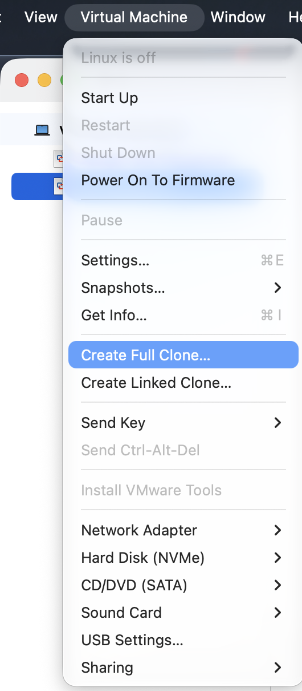
3. Name it clearly, for example `kali-bughunt`.

The original stays your practice machine. All the changes below happen only in
the clone.

## Step 2: Isolate the clone

Before first boot, in the clone's settings:

- Use **NAT** networking, not bridged. Bridged puts the VM on your home network
  with its own address. In Fusion, open **Virtual Machine**, **Settings...**
  (`Cmd+E`), then **Network Adapter**, and choose **Share with my Mac**, which
  is NAT.

  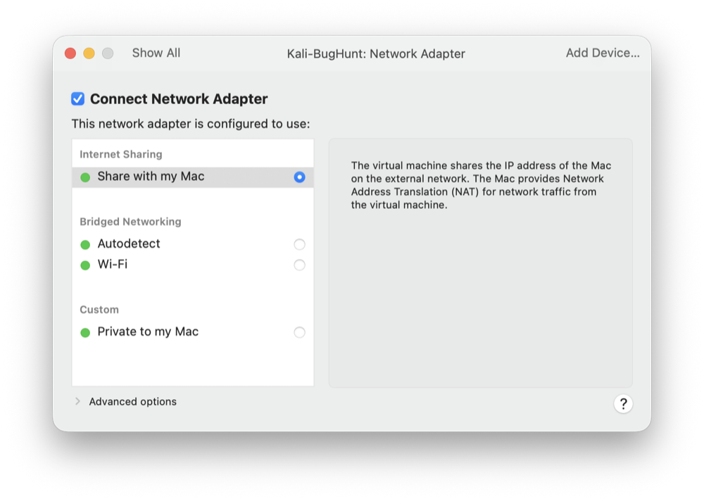
- Turn off **shared folders**. In Settings, **Sharing**, leave **Enable Shared
  Folders** unticked.

  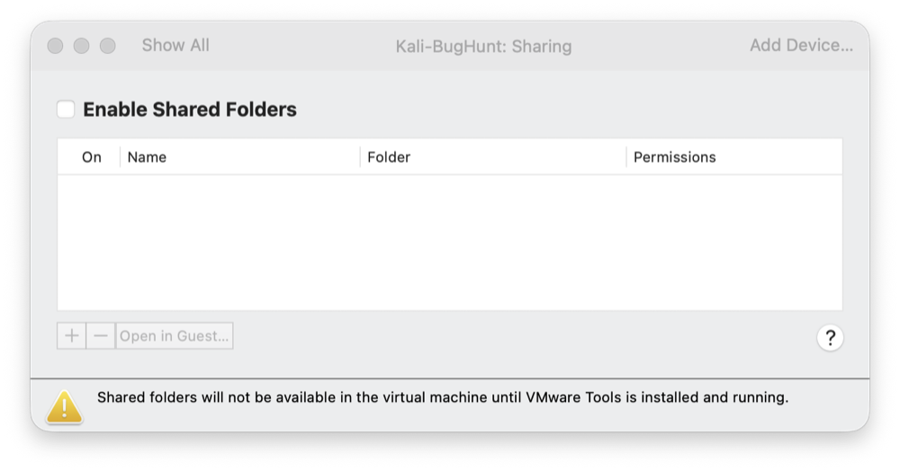
- Turn off drag-and-drop. Keep clipboard sharing off while you test live
  targets (it works in both directions). In Settings, **Isolation**, leave both
  boxes unticked.

  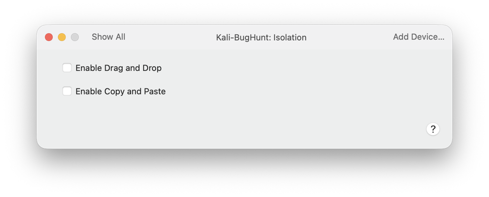

I then kept my notes on the host machine, outside the VM (see step 7), so I
never needed a standing file channel.

## Step 3: Clean the clone

Do this inside the clone only. Think of it as moving out of a flat.

### Update first

```sh
sudo apt update && sudo apt full-upgrade -y
sudo reboot
```

If you run `sudo apt update && apt full-upgrade -y`, the second half fails with
"Permission denied". `sudo` only covers the command right after it.

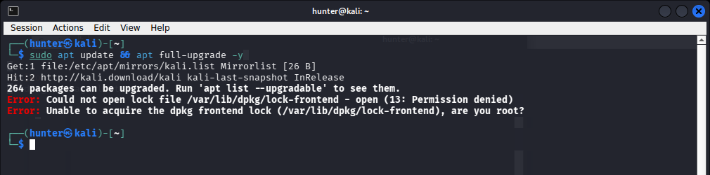

If downloads fail with `Unable to connect to <mirror>`, see the
troubleshooting section.

### Remove lab leftovers

- **VPN configs:** `find ~ -name '*.ovpn' 2>/dev/null` and
  `ls -A /etc/openvpn/client /etc/openvpn/server`. Delete any profiles. Check
  that no VPN service runs: `systemctl list-units --type=service | grep -i
  openvpn` should print nothing.
- **Keys and credentials:** `ls -la ~/.ssh ~/.gnupg` and `ls -a ~`. Look for
  private keys (`id_rsa`, `id_ed25519`), `.aws`, `.netrc`, `.git-credentials`,
  and lab-tool data folders. Remove what you do not need. Do not delete a key
  you cannot account for without checking what it is for.
- **Config folders:** `ls ~/.config`. Some tools keep API keys there. To check
  a config for keys without printing them, count the non-empty lines:
  `grep -v -E '^#|: \[\]$|^$' <file> | wc -l`.
- **Command history:** `grep -i -E 'pass|token|secret|key' ~/.zsh_history |
  head -20`. If real secrets appear, delete the history file and open a new
  terminal.
- **`/etc/hosts`:** remove old lab entries that map practice-room names to
  addresses. Check with `cat /etc/hosts`.

### Give the clone its own identity

A clone starts as a copy of the original, so change what should be unique.

1. **Hostname:** `sudo hostnamectl set-hostname kali-bughunt`. Then fix the
   `127.0.1.1` line in `/etc/hosts` to use the new name. If you do not, `sudo`
   warns `unable to resolve host`.
2. **Machine ID:**

   ```sh
   sudo rm -f /etc/machine-id /var/lib/dbus/machine-id
   sudo systemd-machine-id-setup
   sudo ln -sf /etc/machine-id /var/lib/dbus/machine-id
   ```

   Read the message the setup prints:

   - **"Initializing machine ID from random generator"** is what you want.
   - **"Initializing machine ID from D-Bus machine ID"** means the old ID was
     copied from the second file. I made this mistake on my clone by removing
     only one of the two files. Remove both and run it again.
   - **"Reusing machine ID stored in /run/machine-id"** is what a freshly
     booted cloud image showed in my test VM. Systemd had generated that ID at
     boot, so it is not copied from an original. After a reboot, the same
     commands printed "from random generator".

   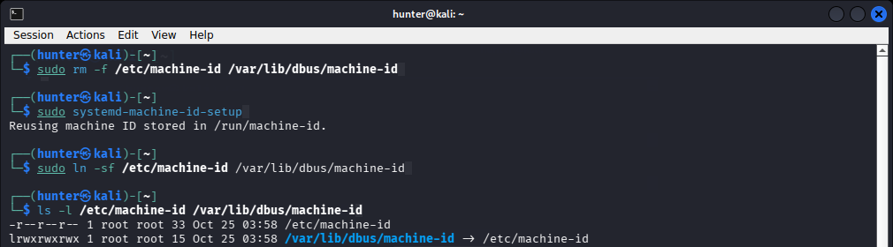

   This figure shows the third case above: the freshly booted cloud image
   reused the ID that systemd had generated at boot.

   The real test is to compare. Run `cat /etc/machine-id` in the original VM and
   in the clone. The two values must differ. Do not publish either one.
3. **SSH host keys:**

   ```sh
   sudo rm -f /etc/ssh/ssh_host_*
   sudo dpkg-reconfigure openssh-server
   systemctl is-active ssh
   systemctl is-enabled ssh
   ```

   You want `inactive` and `disabled`. SSH stays off except while you transfer
   a file.

   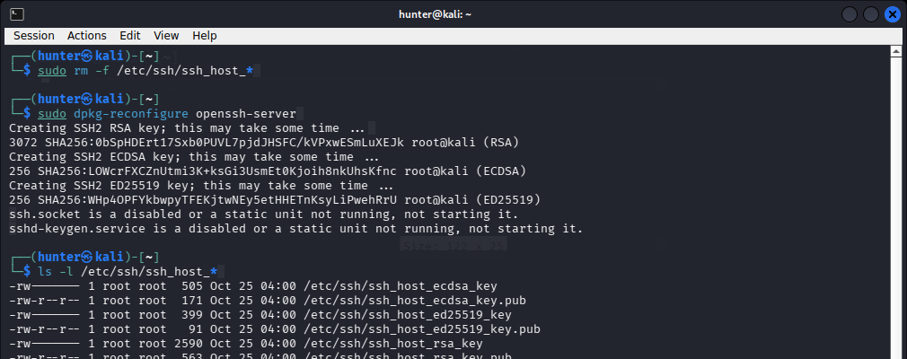

   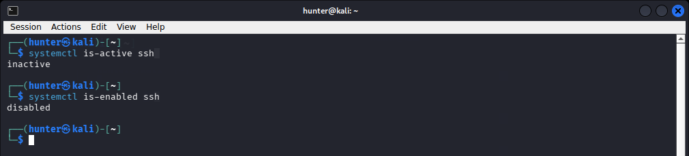
4. **Password:** run `passwd`. Use a new one and store it in a password
   manager.

Do not sign in to personal accounts (email, GitHub, cloud) in this VM. The only
logins here should be test accounts.

### Reset the browser

Open `about:profiles` in Firefox. Create a new profile named `Hunt`. Remove the
old ones and choose **Delete Files**. If you remove a profile without that
option, its folder stays behind. Check and delete it by hand:

```sh
ls ~/.mozilla/firefox ~/.cache/mozilla/firefox
```

Keep only your new profile's folder, plus Firefox's own `installs.ini`,
`profiles.ini` and similar files.

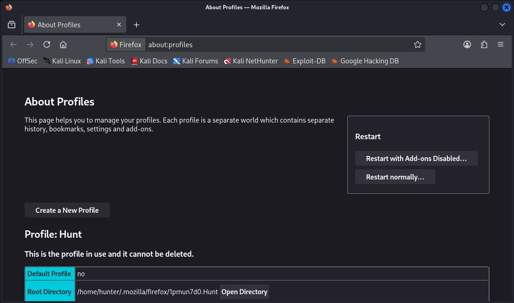

## Step 4: Know your outside address, then snapshot

1. Make sure no VPN is running, unless a programme allows one.
2. Check what the internet sees, for example `curl -s https://ifconfig.me`.
   This uses a third-party service that echoes your address back. On a home
   connection, the address is usually your router's, and it can change. Note the
   date with it.
3. Shut the VM down fully (not suspend) and take a snapshot. In Fusion that is
   **Virtual Machine**, **Snapshots...**, then the camera button. I named mine
   `clean-baseline`. The snapshot manager then shows it, with the VM's current
   state as a child of it.

   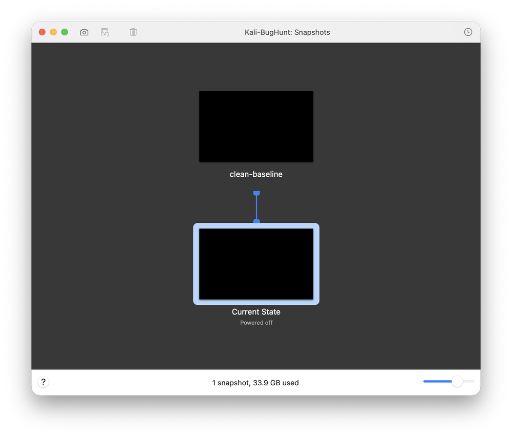

Keep your address in private notes, not in anything you publish.

## Step 5: Burp Suite and a hunting browser

Burp Suite sits between your browser and a site, so you can see every request.

1. Start Burp. Read and accept the licence agreement if you agree with it. The
   version I used (Community Edition 2026.8) then asks which edition to
   continue with: choose **Community Edition**. Pick **Temporary project in
   memory** (project files are a Professional feature), then **Use Burp
   defaults**, then **Start Burp**.

   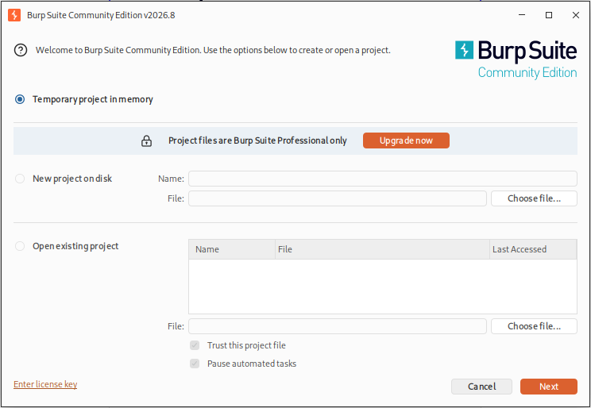

   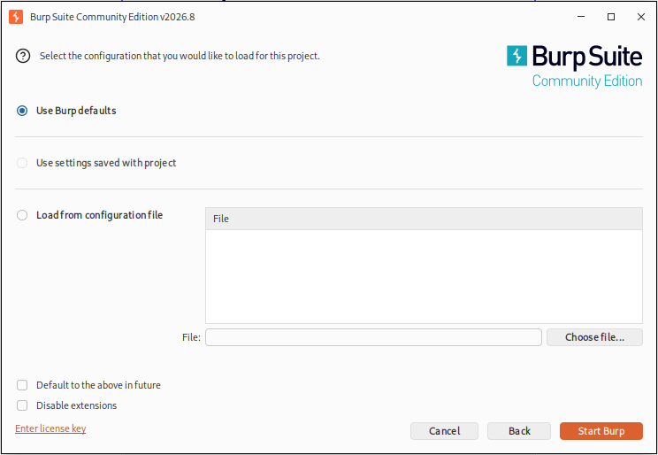
2. Check the proxy listener (Proxy, then Proxy settings) is running on
   `127.0.0.1:8080`.

   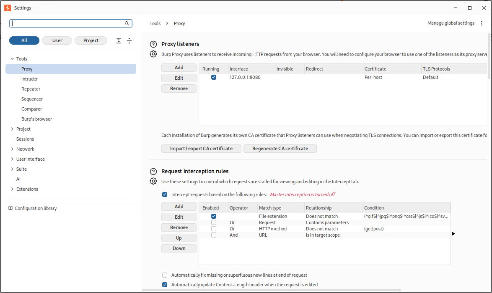
3. In the `Hunt` profile, set **Manual proxy configuration** to `127.0.0.1`,
   port `8080`, and tick the box to use it for HTTPS as well. In Firefox,
   search Settings for "proxy" and open **Settings...** under Network Settings.

   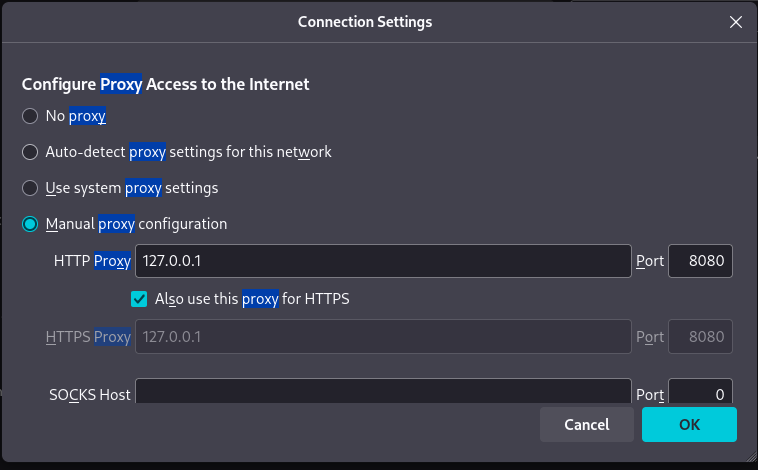
4. With Burp running, visit `http://burpsuite` in that browser and download the
   CA certificate. In Firefox, import it under Settings, Privacy & Security,
   Certificates, View Certificates, Authorities. Tick **Trust this CA to
   identify websites**. Do this in the hunting profile only. (In my test VM I
   imported it from the command line with `certutil` instead, which has the
   same effect.) Then browse to a harmless public page such as
   `https://example.com`. You should see the padlock and no certificate
   warning.

   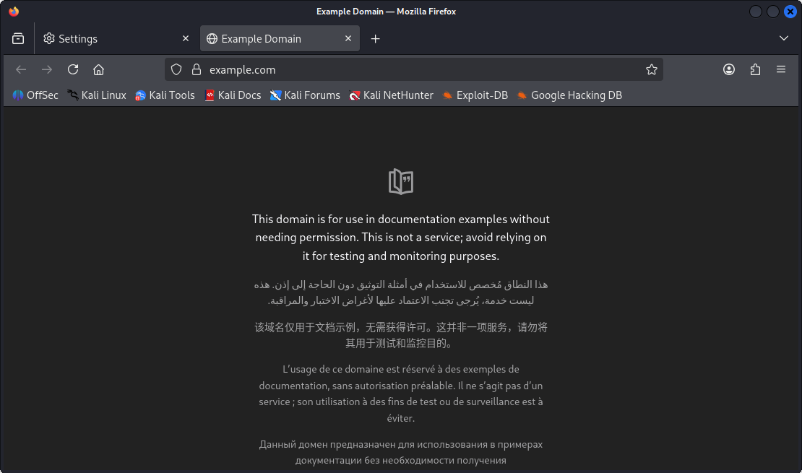
5. Add the sites you are allowed to test to Burp's scope (Target, Scope). Burp
   asks whether to stop sending out-of-scope items to history and other tools.
   Answering **Yes** keeps your history tidy.

   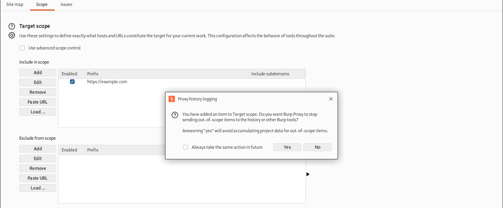

   Then, in Proxy, HTTP history, open the filter and tick **Show only in-scope
   items**.

   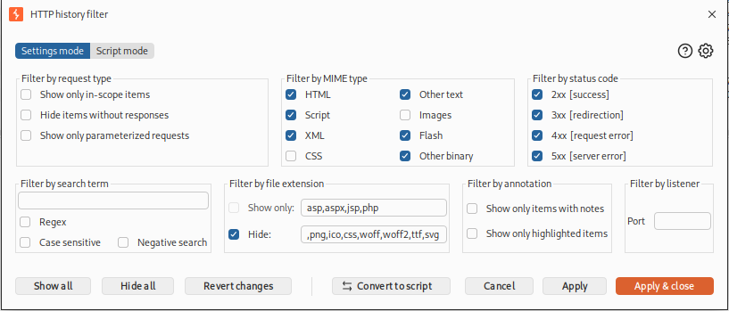

   Before the filter, Firefox's own background requests (to Mozilla services)
   fill the history. Afterwards only the in-scope request remains.

   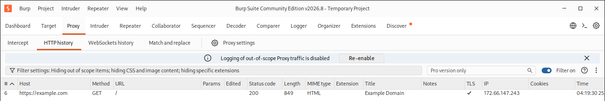

   The scope prompt only stops Burp from recording out-of-scope traffic. It
   does not stop the proxy forwarding it, so it is a tidiness setting, not a
   safety lock.
6. Under Proxy, Intercept, make sure it says **Intercept off** so pages load
   normally. It was off by default in my version.

   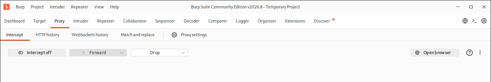

## Step 6: Prove it works

Browse to a site you are allowed to look at, with the Burp proxy on, and check
the requests appear in Proxy, HTTP history. I loaded a public site's sign-in
page and did not log in. HTTPS pages loaded without a certificate warning.

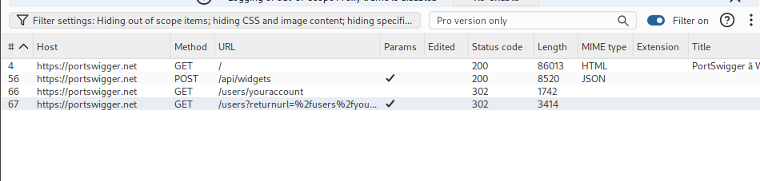

The two `302` rows are redirects. They show the sign-in flow handing off to a
login service on another host, which my scope hid. That is a useful early
lesson: scope controls what you see as well as what you test.

## Step 7: Keep your notes outside the VM

- **A snapshot rollback wipes the VM.** Anything stored inside goes with it.
- **Typing notes on the host needs no channel.** Take screenshots from the host
  side (on a Mac, `Cmd+Shift+4`, then Space, then click the VM window). Nothing
  crosses the VM boundary, so sharing can stay off.

**Keep the notes outside any git repository, even a private one.** A private
repository that you push still stores your notes on the hosting service, and a
stray `git add .` can sweep them in. Use a plain folder such as
`~/BugHunt-Private/`, with one sub-folder per programme, and keep it out of any
folder you open with an AI coding assistant, since those tools can read what is
in their working folder.

Make sure disk encryption is on, and decide on purpose whether the folder syncs
to a cloud service. Treat unfixed finding details as confidential: most
programmes forbid discussing them outside the programme, and some have rules
about AI tools.

A blank template for per-programme notes is in
[programme-notes-template.md](programme-notes-template.md). Copy it for each
programme and fill it in from the policy page before you test anything.

To pull evidence out for a report, deliberately and once:

1. In the VM, start SSH only for the transfer: `sudo systemctl start ssh`.
2. From the **host**, start the copy with `scp`, so the VM never holds a login
   for your host machine.
3. Stop SSH again: `sudo systemctl stop ssh`.
4. Treat what arrives as untrusted. Check it with `file` (if it is missing,
   `sudo apt install file`), prefer text, PNG and PDF, and do not open
   macro-capable documents or run anything from the VM.

## Troubleshooting

**`apt full-upgrade` fails with `Unable to connect to <mirror>`.** Kali's
download address redirects to one of many mirrors, and the one you were sent to
may be down. First check the VM has internet (`ping -c 3 1.1.1.1`). Then test
other mirrors before you use one:

```sh
curl -sI -m 10 -o /dev/null -w '%{http_code}\n' \
  http://<mirror>/kali/dists/kali-rolling/InRelease
```

A `200` means it works, and `000` means no answer:

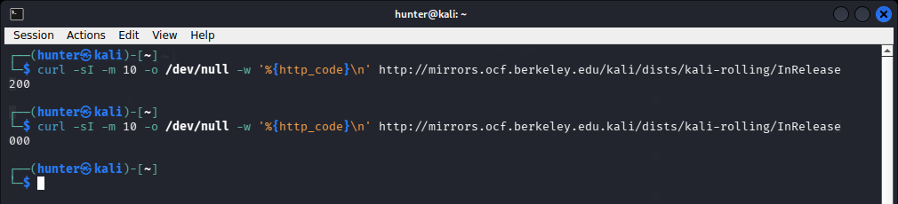

Back up the file that names your mirror, then point it at that mirror. Where
that file is depends on the image:

- On my installed Kali VM it was `/etc/apt/sources.list`, with a line starting
  `deb http://http.kali.org/kali`.
- On a fresh Kali 2026.2 cloud image, `/etc/apt/sources.list` is only a comment.
  The sources are in `/etc/apt/sources.list.d/kali.sources`, which reads its
  mirror from a one-line file, `/etc/apt/mirrors/kali.list`. Put the mirror's
  address there, for example `http://<mirror>/kali`. I tested this: after the
  change, `apt update` fetched from the new mirror.

Look at `/etc/apt/sources.list` first, and follow it if it only points
elsewhere. Watch the slash in the address: `/kali`, not `.kali`, which gave me
`Could not resolve` the first time. Package signatures are still checked, so an
unusual mirror cannot slip in altered packages.

**A restart prompt appears during the upgrade.** The dialog asks whether to
restart services automatically. On a disposable hunting VM, **Yes** is fine.

**You cannot paste into the VM.** That is a side effect of turning clipboard
sharing off. Use short one-line commands, and type them. Avoid multi-line
shell loops, which are easy to mistype.

## What I would do differently

- Check both machine-ID files from the start.
- Use the host's screenshot tool from the beginning, rather than trying to move
  files out of the VM.
- Choose a mirror before starting the upgrade if you know yours is flaky.

## Where to go next

Learn to read requests and responses fluently, then practise on targets built to
be attacked (such as PortSwigger's Web Security Academy or OWASP Juice Shop),
before choosing a programme with a short, clear scope. Read its policy first,
every time.
