# Build Your Own LazyVim Coding Playground: One Key to Run Python, C, Java, Web, JavaScript & JSON

*By James Pearson · 18 October 2026 · Checked on macOS (Apple Silicon) · Linux notes included, but not fully verified*

*Last updated: 18 October 2026*

> **New here?** This is the hands-on guide. For the story behind it (why I built it and what broke along the way), read **[One Key to Run Them All](https://github.com/james-s-pearson/Cybersecurity-Portfolio/blob/main/foundations/lazyvim-ide/lazyvim-playground-story.md)**.

By the end of this guide you'll have a terminal-based editor where you open a file in any of six languages, press **F5**, and see the result in a split next to your code. Plan on about **60–90 minutes**, most of it waiting on installs. I have a special interest in cybersecurity, and I built this as a place to practice the languages and formats that show up throughout the field. But you don't need a security background to follow along.


*A Python file on the left and its IPython output on the right, after one press of F5.*

*The screenshots in this guide were taken in a test folder, so file paths read `/private/tmp/shots/...`. Yours will show your own folder.*

---

## What you'll build

| Language | F5 does this |
|---|---|
| Python | Runs the file in a persistent IPython shell |
| C | Compiles with `gcc` and runs |
| Java | Compiles with `javac` into a temporary folder, runs, then deletes that folder |
| HTML / CSS | Starts a live-reloading browser preview |
| JavaScript | Runs with Node.js |
| JSON | Validates syntax and reports errors |

Plus: persistent IPython shell splits, send-a-line, one-key close, force-stop, window hopping, and formatters for every language. A full shortcut cheat sheet is at the end.

---

## Before you start

**You should be comfortable with:** opening a terminal, running commands, and basic Neovim movement (`i` to type, `Esc` to stop typing, `:w` to save, `:q` to quit). If Neovim is brand new to you, run `:Tutor` inside Neovim first. It takes about 30 minutes.

**What this guide assumes:**
- macOS with [Homebrew](https://brew.sh) installed, *or* a Debian/Ubuntu-based Linux distro (🐧 notes appear where commands differ).
- `zsh` as your shell (the macOS default). Linux users on `bash`, see the 🐧 note in Step 5.

**Versions I tested with (as of October 2026):**
- Neovim: v0.12.5 · Python: 3.13.7 · IPython: 9.5.0 · Java: OpenJDK 21.0.12.1 LTS (installed via Temurin 21) · Node.js: v26.9.0

---

## Step 1: Install Neovim and LazyVim's prerequisites

LazyVim needs Neovim 0.11.2 or newer (built with LuaJIT), Git 2.19 or newer, and a C compiler (for Treesitter), plus a few helper tools for search, Git, and icons. These minimums come from the [LazyVim README](https://github.com/LazyVim/LazyVim#%EF%B8%8F-requirements). On a Mac, Homebrew installs a current Neovim and Git, and the Xcode command line tools provide the C compiler.

```zsh
brew install neovim git lazygit ripgrep fd
```

Install a **Nerd Font** (adds the icons LazyVim uses) and set it as your terminal's font:

```zsh
brew install --cask font-jetbrains-mono-nerd-font
```

Install Apple's command-line developer tools, which provide the C compiler used in Step 4:

```zsh
xcode-select --install
```

> 🐧 **Linux:** Distro Neovim packages are often too old for LazyVim. Install the latest release from the [Neovim releases page](https://github.com/neovim/neovim/releases) instead. Then: `sudo apt install git ripgrep fd-find build-essential` (`build-essential` provides `gcc`). Install lazygit and a Nerd Font per their project pages.

## Step 2: Install LazyVim

Back up any existing Neovim config first, then clone the LazyVim starter:

```zsh
mv ~/.config/nvim ~/.config/nvim.bak 2>/dev/null
git clone https://github.com/LazyVim/starter ~/.config/nvim
rm -rf ~/.config/nvim/.git
nvim
```

The first launch downloads all of LazyVim's plugins. Let it finish, then quit with `:qa` and reopen `nvim`.

> 💡 **Using a dotfiles repo?** I keep my config in `~/dotfiles/.config/nvim`, symlinked to `~/.config/nvim`. If you don't manage dotfiles, ignore this. Every path below uses the standard `~/.config/nvim`.

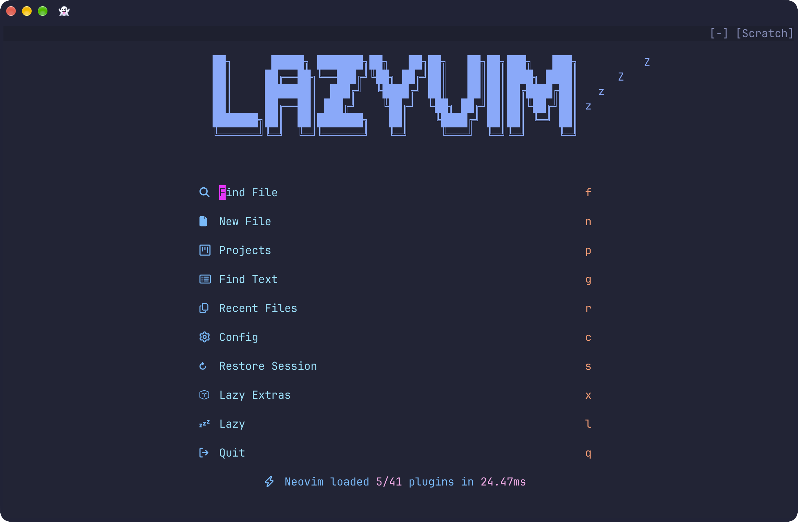

*LazyVim's dashboard on first launch, before any file is open.*

## Step 3: Turn on language support (LazyExtras)

LazyVim ships optional language modules called **Extras**. You can enable them without writing any code:

1. In Neovim, type `:LazyExtras` and press **Enter**.
2. Move to each extra below and press **`x`** to enable it.
3. Restart Neovim, then open any file (for example `nvim notes.txt`). **Mason** (LazyVim's tool installer) downloads the language servers, linters, and formatters in the background. Many of them only start installing once a file is open, so the list in `:Mason` keeps growing after that. Type `:Mason` to watch progress.

Extras I use:

| Extra | Gives you |
|---|---|
| `lang.python` | Python language server and linter (`pyright`, `ruff`) |
| `lang.clangd` | C/C++ language server (`clangd`) |
| `lang.java` | Java language server (`jdtls`) |
| `lang.typescript` | JavaScript/TypeScript language server (`vtsls`) |
| `lang.json` | JSON schemas and validation (`json-lsp`) |
| `lang.tailwind` | CSS/Tailwind completions (`tailwindcss-language-server`) |
| `lang.markdown` | Markdown language server, linting, table of contents, a browser preview for F5 and in-editor rendering (`marksman`, `markdownlint-cli2`, `markdown-toc`, `markdown-preview.nvim`, `render-markdown.nvim`) |
| `lang.toml`, `lang.yaml` | Config-file support (`taplo`, `yaml-language-server`) |
| `formatting.prettier` | Prettier for web files and Markdown (`prettier`) |
| `editor.mini-diff` | Inline diff markers |
| `util.dot`, `util.mini-hipatterns` | Dotfile support, color highlighting |
You may see a few more packages in `:Mason` than the table lists (on my clean test build: `bash-language-server`, `lua-language-server`, `shellcheck`, `shfmt` and `stylua`). They are fine to leave installed.

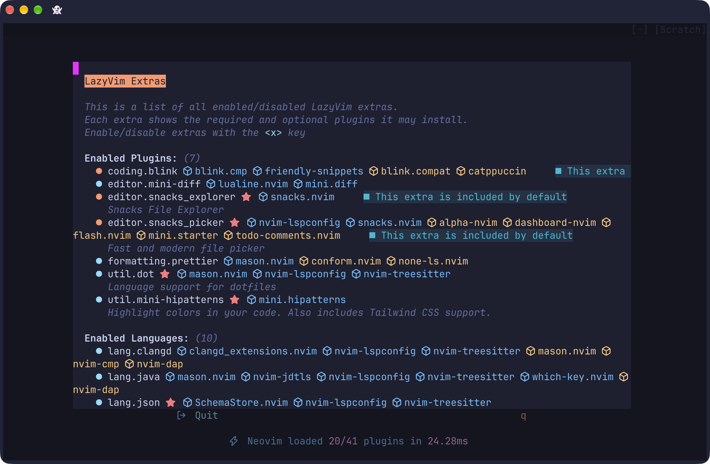

*`:LazyExtras` with the extras enabled. Entries marked "included by default" or "Required by" are added automatically, so the list shows more than the 13 you enable.*


*The same list scrolled down to show all ten enabled language extras.*

**Prefer config files?** You can import the same extras in `~/.config/nvim/lua/config/lazy.lua`, inside the `spec = { ... }` list, after the line that imports `lazyvim.plugins`:

```lua
{ import = "lazyvim.plugins.extras.editor.mini-diff" },
{ import = "lazyvim.plugins.extras.formatting.prettier" },
{ import = "lazyvim.plugins.extras.lang.clangd" },
{ import = "lazyvim.plugins.extras.lang.java" },
{ import = "lazyvim.plugins.extras.lang.json" },
{ import = "lazyvim.plugins.extras.lang.markdown" },
{ import = "lazyvim.plugins.extras.lang.python" },
{ import = "lazyvim.plugins.extras.lang.tailwind" },
{ import = "lazyvim.plugins.extras.lang.toml" },
{ import = "lazyvim.plugins.extras.lang.typescript" },
{ import = "lazyvim.plugins.extras.lang.yaml" },
{ import = "lazyvim.plugins.extras.util.dot" },
{ import = "lazyvim.plugins.extras.util.mini-hipatterns" },
```

Mason installs the language servers above automatically. **Three formatters aren't covered by an extra, so install them yourself:** run `:MasonInstall black clang-format google-java-format`, and type `:Mason` to watch them install. (`prettier` comes with the `formatting.prettier` extra.)

## Step 4: Install each language's toolchain

The editor runs your code with the same tools you'd use in a normal terminal, so those need to be installed too.

**Python + IPython** (IPython powers the persistent Python shell):
```zsh
brew install python
pip3 install ipython
```
> 💡 **If `pip3 install ipython` fails** with an `externally-managed-environment` error, install IPython through Homebrew instead: `brew install ipython`. Current Homebrew Python blocks global `pip` installs (a protection called PEP 668), so readers on current Homebrew Python could hit this error.

**C:** already installed with the Xcode command-line tools in Step 1. Check with `gcc --version`.

**Java** (Eclipse Temurin JDK 21):
```zsh
brew update && brew install --cask temurin@21
java -version
```

**Node.js + live-server** (powers JavaScript, JSON validation, and the HTML preview):
```zsh
brew install node
npm install -g live-server
```
> `live-server` still works, but its latest release (1.2.2) dates from April 2022 and [Snyk](https://security.snyk.io/package/npm/live-server) lists it as inactive. I'm keeping it for now; replacing it is on my list for a future update.

> 🐧 **Linux:** `sudo apt install python3 python3-pip openjdk-21-jdk` · IPython via `sudo apt install ipython3` or `pipx install ipython` · Node.js from [nodejs.org](https://nodejs.org) or `nvm` (distro versions are often old), then `npm install -g live-server`.
> 🐧 **Linux (bash) note:** if the JSON check prints `bash: !: event not found` when you press F5 on a `.json` file, bash is expanding the `!` in the runner's message (history expansion). Run `set +H` in that terminal, or put `set +H` in `~/.bashrc` to turn it off for good. zsh on macOS is not affected.

## Step 5: Add the one-key runner (`repl.lua`)

This is the heart of the playground. LazyVim automatically loads any file inside `lua/plugins/`, so you just create one.

```zsh
mkdir -p ~/.config/nvim/lua/plugins
nvim ~/.config/nvim/lua/plugins/repl.lua
```

Paste in the full file below, save with `:w`, and restart Neovim with `:qa`.

> 💡 **About `Space` and these shortcuts.** `Space` is LazyVim's default "leader" key, the key that starts most custom shortcuts. If you set a different leader, use it wherever you see `Space`: `Space r v` becomes `<leader> r v`. The shortcuts in this file (F5, F6, `Space r v` and `Space r h`, the window-hopping keys and the other terminal keys) are my choices, and they all live in `repl.lua`, so you can change or delete any you don't want. The terminal window-hopping keys are in section 7 of the file.

```lua
return {
  {
    "jpalardy/vim-slime",
    init = function()
      vim.g.slime_target = "neovim"
      vim.g.slime_bracketed_paste = 1
      vim.g.slime_dont_ask_default = 1
    end,
    config = function()
      -- Terminal buffer names end in //PID:command, so this returns the command a terminal was started with
      local function terminal_cmd(buf)
        return vim.api.nvim_buf_get_name(buf):match("//%d+:(.*)$") or ""
      end

      local function is_tool_terminal(cmd)
        return cmd:find("ipython", 1, true) or cmd:find("lazygit", 1, true) or cmd:find("live-server", 1, true)
      end

      -- A hidden terminal (for example the Ctrl+/ one after a second Ctrl+/) is alive but has no window
      local function is_visible(buf)
        return vim.fn.bufwinid(buf) ~= -1
      end

      -- Find an active terminal channel (Split OR Float).
      -- kind "python" only accepts a visible IPython terminal (nil if none, so F5 prints its error message).
      -- kind "shell" only accepts a visible terminal that is not IPython, LazyGit or live-server (nil if none, so
      -- the caller opens a new zsh split). With no kind, the first terminal found is used (the old behaviour).
      local function get_active_terminal_job_id(kind)
        local fallback
        for _, buf in ipairs(vim.api.nvim_list_bufs()) do
          local chan = vim.bo[buf].buftype == "terminal" and vim.b[buf].terminal_job_id
          if chan then
            local cmd = terminal_cmd(buf)
            if kind == "python" and cmd:find("ipython", 1, true) and is_visible(buf) then
              return chan
            end
            if kind == "shell" and not is_tool_terminal(cmd) and is_visible(buf) then
              return chan
            end
            if kind == nil then
              fallback = fallback or chan
            end
          end
        end
        return fallback
      end

      -- 1. Open Python Shell: VERTICAL Split (Space + r + v)
      vim.keymap.set("n", "<leader>rv", function()
        vim.cmd("vsplit | terminal ipython --no-autoindent")
        local term_buf = vim.api.nvim_get_current_buf()
        local term_chan = vim.b[term_buf].terminal_job_id
        vim.cmd("wincmd p")
        vim.b.slime_config = { jobid = term_chan }
      end, { desc = "Python Shell: Vertical Split" })

      -- 2. Open Python Shell: HORIZONTAL Split (Space + r + h)
      vim.keymap.set("n", "<leader>rh", function()
        vim.cmd("split | terminal ipython --no-autoindent")
        local term_buf = vim.api.nvim_get_current_buf()
        local term_chan = vim.b[term_buf].terminal_job_id
        vim.cmd("wincmd p")
        vim.b.slime_config = { jobid = term_chan }
      end, { desc = "Python Shell: Horizontal Split" })

      -- 3. SMART MULTI-LANGUAGE F5 KEYMAP (Python, C, Java, HTML, JS, JSON, & Markdown)
      vim.keymap.set("n", "<F5>", function()
        vim.cmd("w") -- Save the current file

        local file_ext = vim.fn.expand("%:e") -- Get file extension
        local filepath = vim.fn.expand("%:p") -- Get full absolute path
        local filedir = vim.fn.expand("%:p:h") -- Get the folder containing the file
        local filename = vim.fn.expand("%:t:r") -- Get file name without extension
        local filetail = vim.fn.expand("%:t") -- Get full file name with extension

        -- PYTHON WORKFLOW
        if file_ext == "py" then
          local target_chan = get_active_terminal_job_id("python")
          if target_chan then
            vim.b.slime_config = { jobid = target_chan }
            -- A separator line (file name and time) replaces the old %clear, so earlier runs stay in the scrollback
            -- FIXED: %cd forces IPython to match the script's exact folder before running %run
            vim.fn["slime#send"](
              string.format(
                "print('\\n──── %s · %s ────')\n%%cd '%s'\n%%run '%s'\n",
                filetail,
                os.date("%H:%M:%S"),
                filedir,
                filepath
              )
            )
          else
            print("Error: No active Python terminal. Open one with <leader>rv or <leader>rh")
          end

          -- C WORKFLOW (Compile and Run)
        elseif file_ext == "c" then
          local compile_and_run_cmd = string.format(
            "cd '%s' && gcc '%s' -o '%s.out' && clear && ./'%s.out'\n",
            filedir,
            filepath,
            filename,
            filename
          )
          local target_chan = get_active_terminal_job_id("shell")
          if target_chan then
            vim.b.slime_config = { jobid = target_chan }
            vim.fn["slime#send"](compile_and_run_cmd)
          else
            vim.cmd("vsplit | terminal zsh")
            local term_buf = vim.api.nvim_get_current_buf()
            local term_chan = vim.b[term_buf].terminal_job_id
            vim.cmd("wincmd p")
            vim.b.slime_config = { jobid = term_chan }
            vim.fn["slime#send"](compile_and_run_cmd)
          end

          -- JAVA WORKFLOW (Self-Cleaning Compiled Loop)
        elseif file_ext == "java" then
          -- Compile into a temporary folder so nothing is written to, or deleted from, the project folder
          local java_compile_run_clean = string.format(
            "cd '%s' && jtmp=$(mktemp -d) && javac -d \"$jtmp\" '%s' && clear && java -cp \"$jtmp:.\" '%s'; rm -rf \"$jtmp\"\n",
            filedir,
            filepath,
            filename
          )
          local target_chan = get_active_terminal_job_id("shell")
          if target_chan then
            vim.b.slime_config = { jobid = target_chan }
            vim.fn["slime#send"](java_compile_run_clean)
          else
            vim.cmd("vsplit | terminal zsh")
            local term_buf = vim.api.nvim_get_current_buf()
            local term_chan = vim.b[term_buf].terminal_job_id
            vim.cmd("wincmd p")
            vim.b.slime_config = { jobid = term_chan }
            vim.fn["slime#send"](java_compile_run_clean)
          end

          -- HTML WORKFLOW (Live Server Launch)
        elseif file_ext == "html" or file_ext == "css" then
          -- A live-server started for this file's folder counts as running, visible or hidden (it keeps serving)
          local server_running = false
          for _, buf in ipairs(vim.api.nvim_list_bufs()) do
            if vim.bo[buf].buftype == "terminal" then
              local cmd = terminal_cmd(buf)
              if cmd:find("live-server", 1, true) and cmd:find("cd '" .. filedir .. "'", 1, true) then
                server_running = true
                break
              end
            end
          end
          if server_running then
            print("Live Server running. Modifications saved will auto-refresh the browser!")
          else
            local launch_cmd = string.format("split | terminal cd '%s' && live-server --open='%s'", filedir, filetail)
            vim.cmd(launch_cmd)
            vim.cmd("wincmd p")
            print("Launching web preview live server...")
          end

          -- JAVASCRIPT WORKFLOW (Execute via Node.js natively)
        elseif file_ext == "js" then
          local js_run_cmd = string.format("cd '%s' && clear && node '%s'\n", filedir, filetail)
          local target_chan = get_active_terminal_job_id("shell")
          if target_chan then
            vim.b.slime_config = { jobid = target_chan }
            vim.fn["slime#send"](js_run_cmd)
          else
            vim.cmd("vsplit | terminal zsh")
            local term_buf = vim.api.nvim_get_current_buf()
            local term_chan = vim.b[term_buf].terminal_job_id
            vim.cmd("wincmd p")
            vim.b.slime_config = { jobid = term_chan }
            vim.fn["slime#send"](js_run_cmd)
          end

          -- MARKDOWN WORKFLOW (Open a browser preview; each Markdown file gets its own page)
        elseif file_ext == "md" or file_ext == "markdown" then
          -- Open only, never toggle: toggling one file stops the server and closes every preview
          vim.cmd("MarkdownPreview")
          print("Markdown preview opened. Stop all previews with <leader>cp.")

          -- JSON WORKFLOW (Validate syntax)
        elseif file_ext == "json" then
          local json_test_cmd = string.format(
            "clear && node -e \"try { require('%s'); console.log('✅ JSON Structure is Valid!'); } catch(e) { console.error('❌ JSON Error:\\n', e.message); }\"\n",
            filepath
          )
          local target_chan = get_active_terminal_job_id("shell")
          if target_chan then
            vim.b.slime_config = { jobid = target_chan }
            vim.fn["slime#send"](json_test_cmd)
          else
            vim.cmd("vsplit | terminal zsh")
            local term_buf = vim.api.nvim_get_current_buf()
            local term_chan = vim.b[term_buf].terminal_job_id
            vim.cmd("wincmd p")
            vim.b.slime_config = { jobid = term_chan }
            vim.fn["slime#send"](json_test_cmd)
          end
        else
          print("F5 is not configured for ." .. file_ext .. " files yet!")
        end
      end, { desc = "Smart F5: Run current file" })

      -- 4. NEW: ONE-KEY TERMINAL CLOSE SHORTCUT (F6)
      -- Closes the terminal you are in; otherwise the newest visible terminal that is not LazyGit
      local function close_active_terminal()
        local current = vim.api.nvim_get_current_buf()
        if vim.bo[current].buftype == "terminal" then
          vim.cmd("bdelete! " .. current)
          return
        end
        local target
        for _, buf in ipairs(vim.api.nvim_list_bufs()) do
          if
            vim.bo[buf].buftype == "terminal"
            and is_visible(buf)
            and not terminal_cmd(buf):find("lazygit", 1, true)
          then
            target = buf
          end
        end
        if target then
          vim.cmd("bdelete! " .. target)
        else
          print("No open terminal window to close.")
        end
      end
      vim.keymap.set("n", "<F6>", close_active_terminal, { desc = "Close open runner split" })
      vim.keymap.set("t", "<F6>", close_active_terminal, { desc = "Terminal: Close open runner split" })

      -- 5. Force-Kill Keymap for Terminal Mode (Ctrl + c)
      vim.keymap.set("t", "<C-c>", [[<C-\><C-n>i<C-c>]], { desc = "Force-kill frozen script" })

      -- 6. Quick Window Switching (Normal Mode)
      vim.keymap.set("n", "<C-h>", "<C-w>h", { desc = "Go to Left Window" })
      vim.keymap.set("n", "<C-j>", "<C-w>j", { desc = "Go to Bottom Window" })
      vim.keymap.set("n", "<C-k>", "<C-w>k", { desc = "Go to Top Window" })
      vim.keymap.set("n", "<C-l>", "<C-w>l", { desc = "Go to Right Window" })

      -- 7. Quick Window Switching (Terminal Mode)
      -- Trade-off: in a terminal these four keys no longer reach the shell, so Ctrl+l (clear screen),
      -- Ctrl+k (delete to end of line), Ctrl+j (Enter) and Ctrl+h (backspace) are taken.
      vim.keymap.set("t", "<C-h>", [[<C-\><C-n><C-w>h]], { desc = "Terminal: Go Left" })
      vim.keymap.set("t", "<C-j>", [[<C-\><C-n><C-w>j]], { desc = "Terminal: Go Bottom" })
      vim.keymap.set("t", "<C-k>", [[<C-\><C-n><C-w>k]], { desc = "Terminal: Go Top" })
      vim.keymap.set("t", "<C-l>", [[<C-\><C-n><C-w>l]], { desc = "Terminal: Go Right" })

      -- Ctrl+k is taken above, so Ctrl+o sends it to the shell instead (delete from the cursor to end of line)
      vim.keymap.set("t", "<C-o>", function()
        vim.api.nvim_chan_send(vim.b.terminal_job_id, "\11")
      end, { desc = "Terminal: Delete to end of line (sends Ctrl+k)" })

      -- 8. Keep Ctrl+c Ctrl+c in Normal Mode for sending single lines
      vim.keymap.set("n", "<C-c><C-c>", ":SlimeSend<CR>", { silent = true, desc = "Send line to REPL" })
    end,
  },
}
```

> 🐧 **Linux (bash users):** replace each `terminal zsh` in the file above with `terminal bash`.

### Known limitations

- F5 finds your Python shell by the command it was started with, so an IPython you start by hand inside a plain shell isn't recognized. Open it with `Space r v` or `Space r h`.
- A plain `python3` shell doesn't work with F5, because `%cd` and `%run` are IPython features. Support for it is planned for a future update.
- Paths that contain an apostrophe, and Java files with a `package` line, aren't handled.
- C, Java, JavaScript and JSON still clear the screen before each run. Only Python keeps earlier output.

### How the runner works (in plain English)

- **`get_active_terminal_job_id()`** looks through open windows for the right terminal. For Python it wants a *visible* IPython window. For C, Java, JavaScript and JSON it wants a visible plain shell (not IPython, LazyGit or the live-server window). If it finds none, F5 prints a message (Python) or opens a new split (the others). "Visible" matters: pressing `Ctrl + /` a second time hides the floating terminal while its shell keeps running, and a command sent there would show nothing.
- **vim-slime** "types" a command into that terminal for you.
- **The F5 function** reads the file extension and picks a recipe. Each language has its own branch, so changing one can't break another.
- **Python is the special case.** It needs an IPython shell open first (`Space r v`), because that's what lets variables stay in memory after a run. Instead of clearing the screen, F5 prints a separator line with the file name and time, so earlier runs stay in the scrollback. Type `clear` when you want a blank screen.
- **Markdown is the simplest case.** F5 on a `.md` or `.markdown` file just opens a browser preview. It needs no terminal (see Step 8).
- **F6** closes the terminal you're in. From a code window, it closes the newest visible terminal that isn't LazyGit.
- **A trade-off with window hopping:** `Ctrl + h / j / k / l` also work from inside a terminal, which means those four keys no longer reach the shell there. `Ctrl + l` (clear screen), `Ctrl + k` (delete to end of line), `Ctrl + j` (Enter) and `Ctrl + h` (backspace) are taken. I added `Ctrl + o` as a replacement for delete-to-end-of-line.

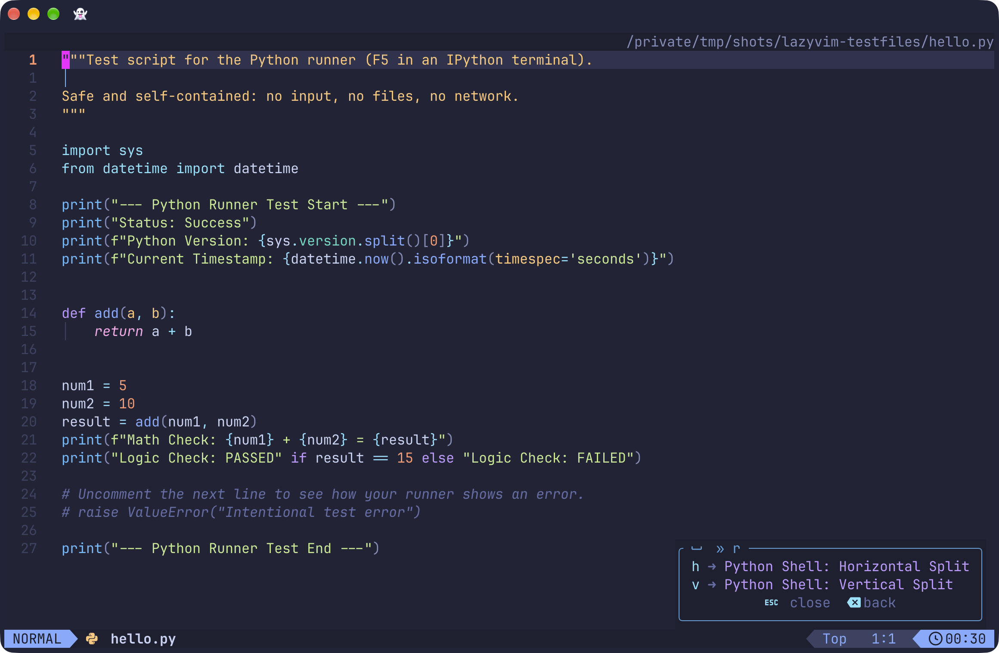

*WhichKey's `Space r` menu: `h` opens a Python shell in a horizontal split, `v` in a vertical split.*

## Step 6: Set up on-demand formatting

My goal was to format **on command** rather than on every save, because auto-format can rewrite entire files you only touched one line of and can override deliberate layout choices.

LazyVim has its own format-on-save, controlled by one switch, `vim.g.autoformat`, which is on by default. Turning that switch off (in `options.lua`, below) is what stops formatting on save while keeping manual formatting.

Create `~/.config/nvim/lua/plugins/formatting.lua`:

```lua
return {
  "stevearc/conform.nvim",
  opts = {
    formatters_by_ft = {
      python = { "black" },
      c = { "clang-format" },
      cpp = { "clang-format" },
      java = { "google-java-format" },
      html = { "prettier" },
      css = { "prettier" },
      javascript = { "prettier" },
      typescript = { "prettier" },
      json = { "prettier" },
      markdown = { "prettier" },
      ["markdown.mdx"] = { "prettier" },
    },
    formatters = {
      prettier = {
        prepend_args = { "--prose-wrap", "always", "--print-width", "80", "--tab-width", "2" },
      },
    },
  },
}
```

Then add these lines to the bottom of `~/.config/nvim/lua/config/options.lua`:

```lua
-- Turn off LazyVim's own format-on-save (Space c f still formats on demand)
vim.g.autoformat = false

-- Let Prettier run even if there is no .prettierrc file in your Git repository
vim.g.lazyvim_prettier_needs_config = false

-- Optional: show the modified flag and full file path, right-aligned, at the top of each window
vim.opt.winbar = "%=%m %F"
```

**To format on demand:** press `Space c f`. **To toggle format-on-save for the current session:** `Space u f`. You can try this on two deliberately messy files at the end of Step 7.

## Step 7: Test every language

Restart Neovim (`:qa`, then `nvim`). You need a few small files to run. I published a set of safe test files, one per language, in [`lazyvim-testfiles`](https://github.com/james-s-pearson/Cybersecurity-Portfolio/tree/main/foundations/lazyvim-ide/lazyvim-testfiles). They are throwaway tests, not examples of my coding, and an AI assistant helped draft them, as it did the setup they test. Every file is self-contained: no input, no network, no personal data.

> **Where this was checked:** on macOS. The runner should also work on Linux (an earlier partial test on Ubuntu-like Linux needed one shell fix, noted in Step 4), but the install steps and these exact test files weren't verified there. Windows isn't covered.

**Get the files** (pick one):

```zsh
git clone https://github.com/james-s-pearson/Cybersecurity-Portfolio.git
cd Cybersecurity-Portfolio/foundations/lazyvim-ide/lazyvim-testfiles
```

or on the repository page choose **Code → Download ZIP**, unzip it, and open the `foundations/lazyvim-ide/lazyvim-testfiles` folder.

Open each file below in Neovim and press **F5**. If a test fails because a tool is missing (`gcc`, `javac`, `node`, `live-server` or `ipython`), go back to Step 4 and install it; the file is not the problem. The first time you press F5 on a C, Java, JavaScript or JSON file with no shell open, the runner opens a new shell split for you.

### Python (`hello.py`)

Open a Python shell first with `Space r v` (or `Space r h` for a horizontal split), then press F5.

✅ **Expect:** a separator line, then `--- Python Runner Test Start ---`, a version and timestamp, `Math Check: 5 + 10 = 15`, `Logic Check: PASSED`, and an end line. Press F5 again: the first run's output stays above the new separator.


*`hello.py` after two runs with F5. The second run starts below a separator line with the file name and time, and the first run stays above it.*

### C (`hello.c`)

✅ **Expect:** `Hello, world!` ten times, each followed by a blank line (the string already ends in a newline, and `puts` adds another). Press F5 again; it reruns in the same pane. The runner leaves a compiled `hello.out` next to the source. That is normal, and the folder's `.gitignore` keeps it out of Git.


*`hello.c` compiled and run with F5: ten `Hello, world!` lines in the shell split.*

### Java (`Hello.java`)

✅ **Expect:** `Java Runner Test: SUCCESS` and `No arguments passed.` The runner compiles into a temporary folder, runs the program and deletes the folder, so no `.class` files appear in your folder.


*`Hello.java` compiled and run with F5: `Java Runner Test: SUCCESS` and `No arguments passed.`*

### JavaScript (`hello.js`)

✅ **Expect:** a start line, `Status: Success`, your Node version, `Unicode Check: ✅ 🚀`, a timestamp, a passed logic check and an end line. If the two symbols show as boxes, your terminal font needs fixing (see Step 1).

### JSON (`valid.json`)

✅ **Expect:** `JSON Structure is Valid!`

> 🐧 **Linux (bash):** if you see `bash: !: event not found`, run `set +H` (see the note in Step 4).

### HTML and CSS (`index.html` and `style.css`)

F5 on `index.html` starts a Live Server and opens the page in your browser. The page has no external links or trackers.

✅ **Expect:** your browser opens the page. Edit the heading in `index.html`, save with `:w`, and the page refreshes by itself. Then open `style.css` and find the line that says `--accent-color: #00b4d8;` (line 4). Change the colour, for example to `#e63946`. Keep the `#` and the `;`, change only that line, and save. The heading colour should change without a reload.

> ⚠️ Don't edit the `color: var(--accent-color);` line further down the file. Replacing that with a plain colour breaks the link to the variable, and the heading turns the wrong colour.

To stop the server, move into its terminal pane and press `Ctrl + c`, or press F6 to close that pane.

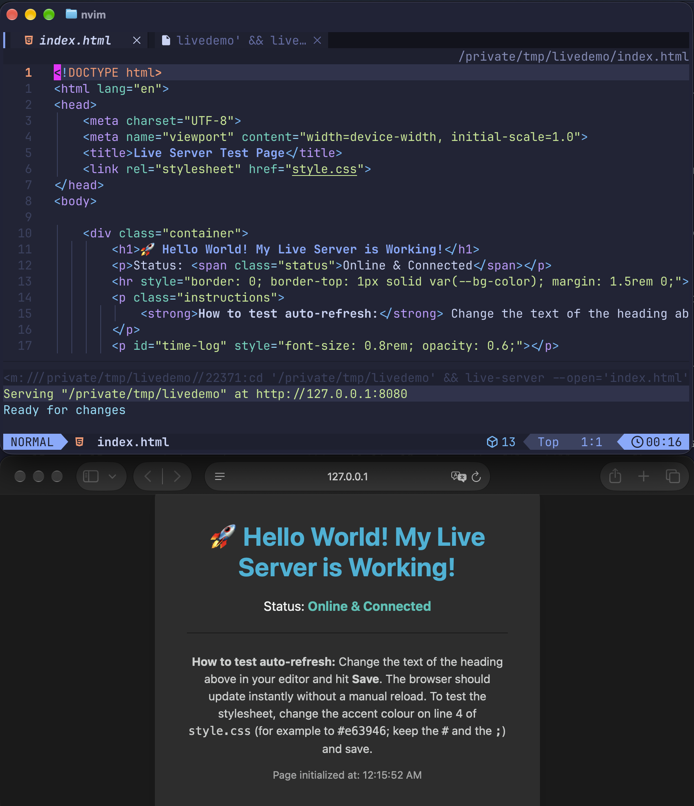

*Before: `index.html` open, Live Server running in the terminal pane, and the page open in the browser.*


*After changing `--accent-color` to `red` in `style.css` and saving (I used `red` instead of `#e63946`): the heading turned red by itself, and the server log shows `CSS change detected`.*

### Optional: more tests

**Check that F5 runs from the script's folder (`folder_check.py`).** Start Neovim from a different folder (for example your home folder), open `folder_check.py` by its path, open a Python shell (`Space r v`), and press F5.

✅ **Expect:** five lines, in this order (the second line is the name of the folder the file sits in):

```text
--- Folder Check Start ---
Script folder: lazyvim-testfiles
Relative file landed in the script folder: yes
Folder Check: PASSED
--- Folder Check End ---
```

The script writes one tiny file next to itself and deletes it, so nothing is left behind. Run with plain `python3` from some other folder, it prints `FAILED` instead, which shows the check can fail.

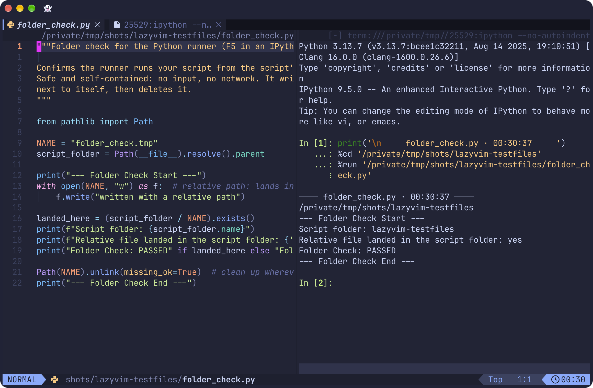

*`folder_check.py` started from a different folder: the file the script writes lands next to the script, and the check passes.*

**See a failed run on purpose.** These files each contain a comment saying they are meant to fail, so you know what a real error looks like in your setup.

- `broken.c`: F5 shows a compiler error for the missing semicolon, with the file name and line number (`broken.c:6`), and runs nothing. The wording depends on your compiler; on macOS it reads `expected ';' after expression`.
- `Broken.java`: F5 shows `Broken.java:5: error: ';' expected` and runs nothing. It leaves no files behind.
- `broken.json`: F5 prints `JSON Error:` and a message that starts `Expected ',' or '}' after property value in JSON`, with the position (line 4, column 3). The message includes the file's full path, so crop it before you share a screenshot.

`hello.py` and `hello.js` also each end with a commented-out error line. Remove the comment markers, press F5, and look at how your setup shows a failed run. Put the markers back afterward.

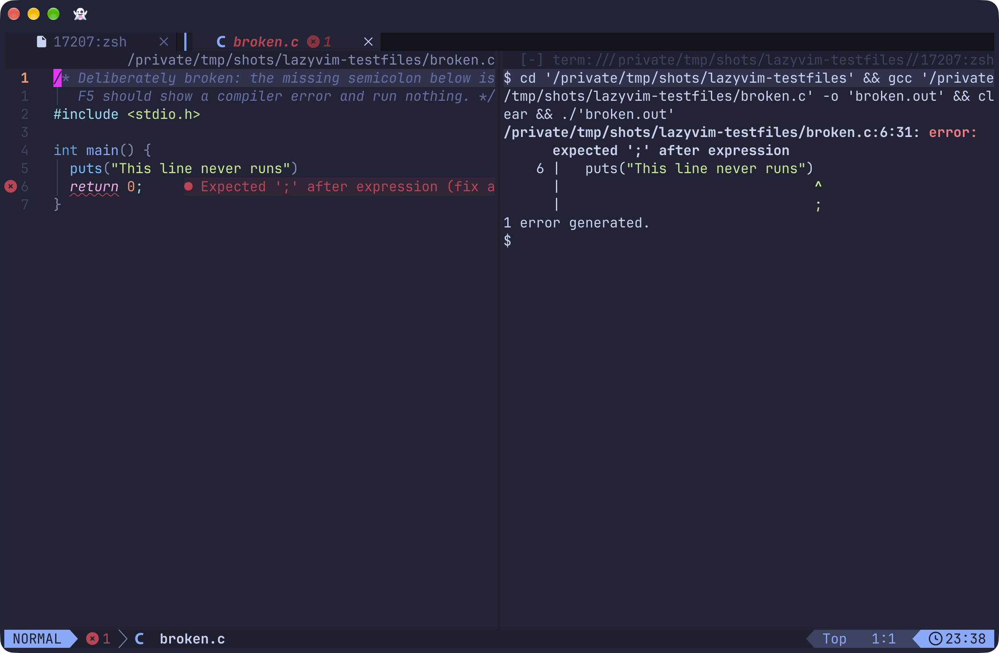

*`broken.c` has a deliberate missing semicolon. F5 prints the compiler error with the file name and position (`broken.c:6:31`) and runs nothing.*

**Try the formatters.** `format_me.py` (formatted by Black) and `format_me.css` (formatted by Prettier) are deliberately messy but valid. Open one, save with `:w` and notice nothing changes (auto-format on save is off, see Step 6), then press `Space c f` and watch it tidy up. F5 on `format_me.py` prints `Total: 5` and `Config: {'name': 'format_me', 'version': 1}`, before and after formatting. `format_me.css` isn't meant to be run: F5 on a `.css` file opens the raw stylesheet in the Live Server, not a page.

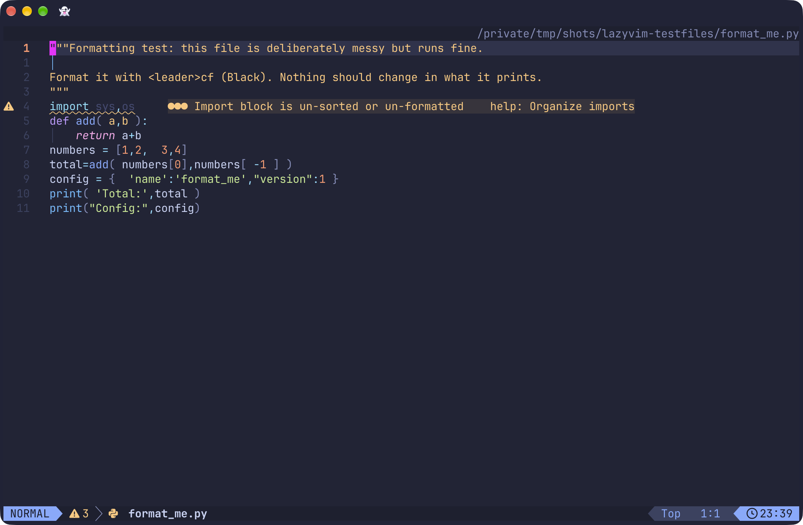

*`format_me.py` as shipped: deliberately messy but valid.*

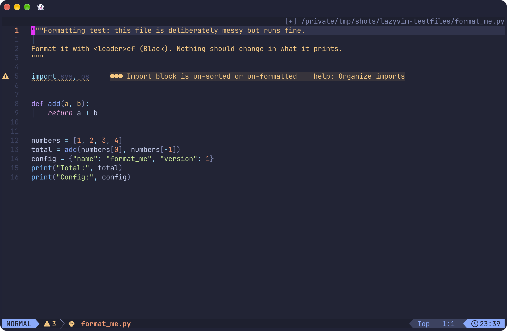

*The same file after formatting with Black: spacing and quotes tidied. The import warning stays, because Black does not sort imports.*

---

## Step 8 (optional): Quality-of-life add-ons

Everything above gives you the full one-key playground. Step 8 is optional. It covers F5 for Markdown files, one plugin I added after weeks of daily use because it made coding smoother, plus a note on other tools I use.

### F5 for Markdown: a live preview in your browser

The `lang.markdown` extra from Step 3 installs two things: `markdown-preview.nvim`, which shows a Markdown file as a web page, and `render-markdown.nvim`, which renders Markdown inside the editor. The `repl.lua` you pasted in Step 5 already has a Markdown branch, so there is nothing more to install. Open a `.md` or `.markdown` file and press **F5** to open the preview in your default browser. It needs Node.js (Step 4) and is served only on your own computer (`127.0.0.1`), on a port picked at random.

You get two views of the same file:

- **In the editor.** `render-markdown.nvim` draws headings, tables and `> [!NOTE]` / `> [!WARNING]` boxes as you read. `Space u m` turns that on and off. Images show as an icon only.
- **In the browser.** F5 opens the preview, and it updates as you type.

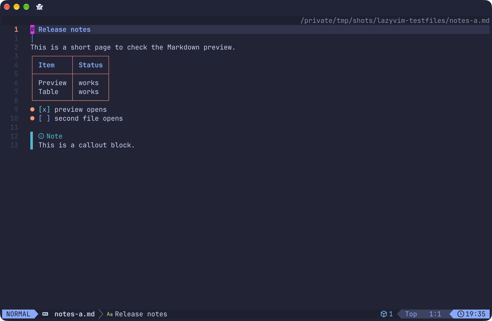

*`notes-a.md` rendered in the editor, before pressing F5.*

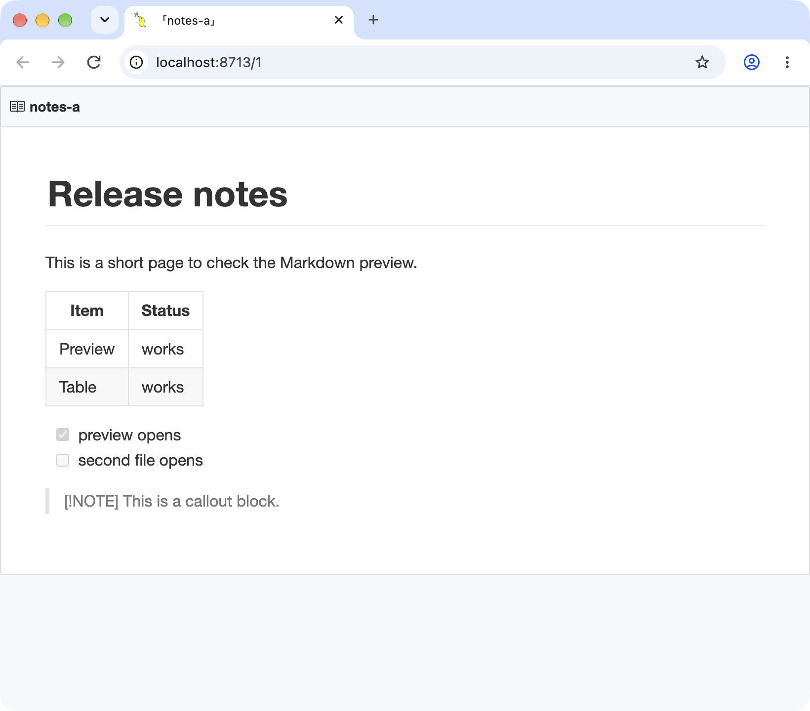

*The browser preview after F5. (In my screenshots the browser window comes from my test setup. On a normal install, the preview opens in your default browser.)*

**Several files at once.** Each file gets its own browser tab. F5 only ever opens a preview; it never toggles one off, because toggling one file would stop the server and close every preview. To stop all previews at once, press `Space c p`.

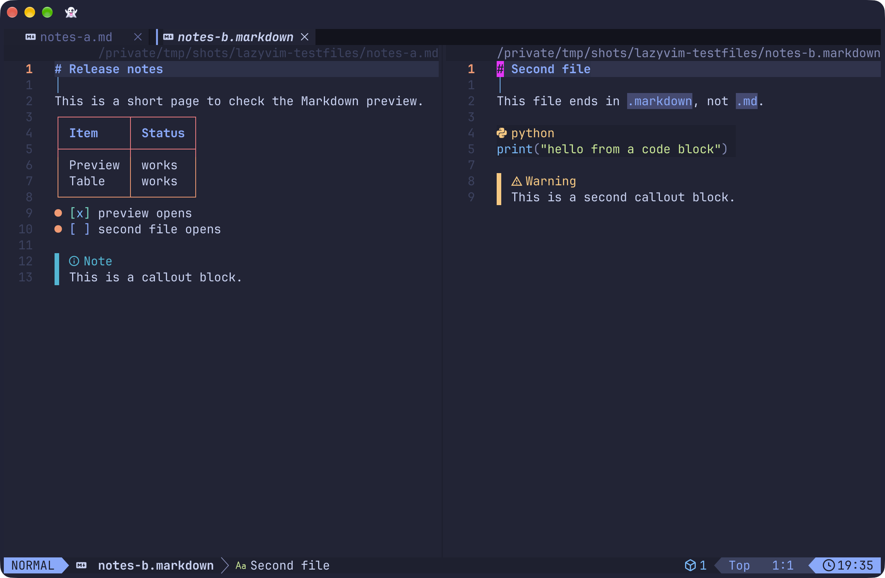

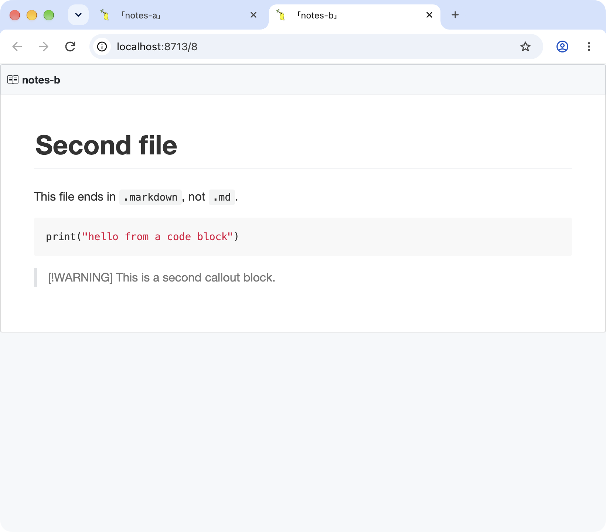

*Two files in two splits, then one browser tab for each.*

**Keep previews open (optional).** By default, `markdown-preview.nvim` closes a file's preview when you hide its buffer, for example by opening another file in the same window. I turned that off so F5 on several files keeps every preview. Add this line to the bottom of `~/.config/nvim/lua/config/options.lua`:

```lua
-- markdown-preview.nvim closes a file's preview when its buffer is hidden (for example when you
-- open another file in the same window). Turn that off so F5 on several files keeps every preview.
vim.g.mkdp_auto_close = 0
```

The cost: previews stay open until you close their tabs or press `Space c p`, so browser tabs can pile up.

**Known limitations.**

- The browser preview shows `> [!NOTE]` and `> [!WARNING]` callouts as plain quotes. The editor view shows them as "Note" and "Warning" boxes. I'm accepting that for now, and I expect to replace this plugin with a more actively maintained one later (something like `live-server`, which the HTML runner already uses).
- The last commit to `markdown-preview.nvim` was in October 2023, as I write this (18 October 2026). It worked on my clean test build.

**Try it.** Open the two Markdown files in [`lazyvim-testfiles`](https://github.com/james-s-pearson/Cybersecurity-Portfolio/tree/main/foundations/lazyvim-ide/lazyvim-testfiles), `notes-a.md` and `notes-b.markdown`, and press F5 on each. The test files have no images, so also try F5 on a `.md` or `.markdown` file of your own that includes one. An image appears when its path is relative to the Markdown file, and the editor view shows only an icon. If an image doesn't appear, check the path first.

### Easier undo history with Undotree

Undotree shows your edit history as a tree, so you can jump back to an earlier version of the file instead of pressing `u` over and over. Create `~/.config/nvim/lua/plugins/undotree.lua`:

```lua
return {
  "mbbill/undotree",
  keys = {
    -- Space + u + u toggles the Undotree window
    { "<leader>uu", "<cmd>UndotreeToggle<cr>", desc = "Toggle Undotree" },
  },
}
```

Restart Neovim, then press `Space u u` to open or close the panel.

### Other tools on my machine

Beyond the six languages in this guide, my Mason list also has tools for shell scripts (a fresh install already includes `bash-language-server`, `shellcheck` and `shfmt`), Go (`golangci-lint`), Git (`gitleaks`, `gitlint`), spell-checking code (`typos`), CSS (`csskit`, an all-in-one CSS toolchain written in Rust; I use Tailwind for my own CSS, so it's optional), and for JavaScript and Markdown: `eslint_d`, `prettierd`, `markdownlint` and `mdformat`. Installing a tool from Mason doesn't switch it on. On a clean build, formatting stayed on Prettier and the only active Markdown linter was `markdownlint-cli2`, so those four need their own configuration, which this guide doesn't cover. I'm not covering any of these tools here.

---

## Shortcut cheat sheet

| Keys | Action |
|---|---|
| `F5` | Save and run the current file. On a Markdown file, it opens a browser preview instead |
| `F6` | Close the terminal you're in, or the newest visible runner terminal |
| `Space r v` / `Space r h` | Open a Python (IPython) shell, vertical / horizontal |
| `Ctrl+c Ctrl+c` | Send the current line to the shell |
| `Ctrl + /` | Toggle LazyVim's terminal (it opens docked at the bottom of the screen). F5 can use it for C, Java, JavaScript and JSON, but not for Python (Python needs a shell opened with `Space r v` / `Space r h`) |
| `Ctrl + h / j / k / l` | Move to the window left / below / above / right (works from inside a terminal too) |
| `Ctrl + o` (in a terminal) | Delete to end of line (sends `Ctrl + k` to the shell) |
| `Ctrl + \` then `Ctrl + n` | Neovim's built-in way out of a terminal (two separate keystrokes; don't confuse with `Ctrl + /`) |
| `Ctrl + c` (in a terminal) | Stop a running script |
| `Space c f` | Format the current file |
| `Space u f` | Toggle format-on-save for this session |
| `Space u d` | Hide or show diagnostics (the error and warning messages). Hiding doesn't clear them or stop your language servers. Useful when they clutter a file you're only reading (for example Markdown line-length warnings like MD013), or when you've imported a module you haven't used yet |
| `V` then `gc` | Comment / uncomment selected lines |
| `Space c p` | Stop all Markdown previews at once (Step 8) |
| `Space u m` | Turn in-editor Markdown rendering on or off (Step 8) |
| `Space g g` | Open LazyGit |
| `Space u u` | Toggle Undotree (optional add-on, Step 8) |

---

## Troubleshooting

Every one of these happened to me while building this.

| Symptom | Cause | Fix |
|---|---|---|
| Python shell stuck on `...` after F5 | Plain `python3` shell treats pasted code as one block | Use IPython (Step 4); open the shell with `Space r v` |
| `NameError: name 'clear' is not defined` | `clear` isn't Python | Use IPython (Step 4); in IPython, type `clear` for a blank screen. F5 no longer clears for you |
| Paths with spaces break | The shell splits the path at the space | Wrap paths in quotes (already in `repl.lua`) |
| `FileNotFoundError` for a file next to your script | Shell is running from a different folder | F5 now runs `%cd` into the script's folder first |
| C runs once, then F5 does nothing | The terminal process ended after the first run | Runner opens a persistent `zsh` shell (already in `repl.lua`) |
| `^[[200~` characters or Java code pasted into the shell | Interactive Java shell wasn't ready / wrong target | Java uses `javac` + `java` instead (already in `repl.lua`) |
| HTML preview shows a 404 | Server pointed at one file instead of the folder | Serve the folder and open by name (already in `repl.lua`) |
| Error and warning messages (underlines, red and yellow text) suddenly disappear | Diagnostics were hidden with `Space u d`. They aren't cleared, and your linters and language servers are still running | Press `Space u d` again to show them |
| Browser tabs from Markdown previews pile up, or a preview won't close | `mkdp_auto_close = 0` keeps every preview open until you close it | Close the tabs, or press `Space c p` to stop all previews (Step 8) |
| `E5108` error when formatting | Config syntax the formatter plugin no longer accepts | Use the flat lists in Step 6 |
| Prettier won't format in a Git repo | Prettier waits for a project config file | `vim.g.lazyvim_prettier_needs_config = false` (Step 6) |
| F5 seems to do nothing after pressing `Ctrl + /` twice | The second press (with the cursor inside the terminal) hides the terminal window; its shell keeps running but has no window | `repl.lua` only uses visible terminals. Press `Ctrl + /` again, or let F5 open a new split |
| F5 shows `E382: Cannot write, 'buftype' option is set` | F5 saves the file first, and the cursor was inside a terminal window, not the code file | Click or move back to the code window and press F5 again |
| F5 on a C file shows `[Errno 2] No such file or directory` in an `In [1]:` prompt | The visible shell is running IPython, so the compile command was typed into IPython | Type `exit` in that shell, then press F5 again |
| Edited a helper module, but F5 still shows the old behavior | IPython caches imported modules for the whole session (`%run` only gives your script a fresh namespace) | Restart the IPython shell (`F6`, then `Space r v`), or run the file with `python3` in a normal shell |
| `Ctrl + l`, `Ctrl + k`, `Ctrl + j` or `Ctrl + h` don't work in a terminal | `repl.lua` maps them to window hopping in terminal mode | Use `Ctrl + o` for delete-to-end-of-line and type `clear`; or delete the terminal-mode mappings in section 7 of `repl.lua` |
| Shortcut does something unexpected | Clash with a LazyVim default | Press `Space` and pause to see the WhichKey menu; check [LazyVim's keymaps](https://www.lazyvim.org/keymaps) |

---

## Where to go next

- Add another language: copy one of the `elseif` blocks in `repl.lua` and change the extension and command.
- Explore LazyVim's documentation at [lazyvim.org](https://www.lazyvim.org).
- Read the story behind this setup: **[One Key to Run Them All](https://github.com/james-s-pearson/Cybersecurity-Portfolio/blob/main/foundations/lazyvim-ide/lazyvim-playground-story.md)**.

Questions or improvements? I'd love to hear how your build goes.

**Find me online:** [LinkedIn](https://www.linkedin.com/in/jamespearson1562) · [GitHub](https://github.com/james-s-pearson) · [Portfolio repository](https://github.com/james-s-pearson/Cybersecurity-Portfolio) · [TryHackMe](https://tryhackme.com/p/JamesPearson)
