# One Key to Run Them All: How I Turned LazyVim into a Multi-Language Coding Playground

*By James Pearson · 18 October 2026 · ~13 min read*

> **Want to build this yourself?** This post is the story: what I built, why, and what broke along the way. If you'd rather skip straight to the step-by-step setup, head to the companion guide: **[Build Your Own LazyVim Coding Playground](https://github.com/james-s-pearson/Cybersecurity-Portfolio/blob/main/foundations/lazyvim-ide/lazyvim-playground-howto.md)**.

---

## The problem: too many setups, not enough coding

I have a special interest in cybersecurity, and I built this as a place to practice the languages and formats that show up throughout the field. I want to understand how they work on their own and together, so I can better understand how vulnerabilities are created (intentionally and unintentionally), how they show up in the wild (misconfiguration, poorly written or stacked code, broken connectors, unused libraries), how they're exploited and, most importantly, how they're protected.

To that end, I'm exploring and learning: Python, C, Java, HTML/CSS, JavaScript, and JSON. Every one of them came with its own way of doing things. Python had IDLE. Java wanted a compiler and a separate run step. C needed `gcc`. Web pages needed a browser and a server. Before I'd written a single line of logic, I was juggling windows, tools, and terminal commands.

That friction adds up. When you're a beginner, every extra step between "I wrote some code" and "I can see what it does" is a chance to lose momentum.

So I set myself a goal: **build one coding playground, inside one editor, where any of those languages runs with a single keypress.** I chose LazyVim (a ready-made configuration of the Neovim terminal editor), because I already spend a lot of time in the terminal and wanted a setup I'd fully understand and own.

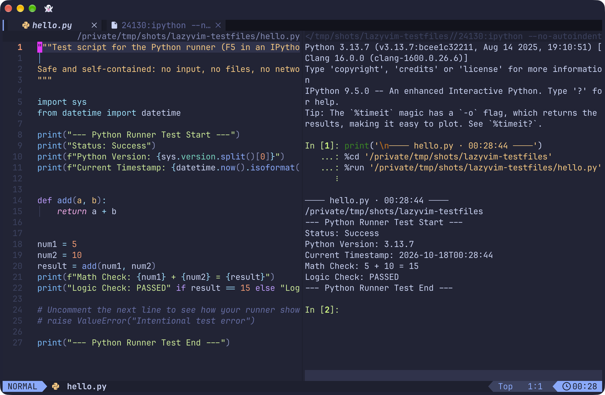

*The playground: code on the left, IPython output on the right.*

---

## What the playground can do

Here's the finished feature set. The headline is **F5**: open any supported file, press F5, and it saves, builds (if needed), and runs, with the output appearing in a split right next to your code.

| Language | What F5 does | Under the hood |
|---|---|---|
| **Python** | Runs the whole file in a live, persistent interactive shell (it keeps your variables after each run) | IPython `%run`, sent via vim-slime |
| **C** | Compiles and runs in one step | `gcc` → run the binary |
| **Java** | Compiles into a temporary folder, runs, then deletes that folder | `javac` → `java` → remove the temporary folder |
| **HTML / CSS** | Launches a local web server and opens a browser preview that auto-refreshes on save | `live-server` |
| **JavaScript** | Runs the script | Node.js |
| **JSON** | Checks the file is valid and points to any syntax error | Node.js parser |

On top of the one-key runner, I added:

- **A persistent IPython shell** in a vertical (`Space r v`) or horizontal (`Space r h`) split, which keeps variables in memory after a run so I can poke at results. (`Space` is LazyVim's default "leader" key, the key that starts most custom shortcuts. If you set a different leader, use it wherever you see `Space`: `Space r v` becomes `<leader> r v`.)
- **Send a single line** of code to the shell with `Ctrl+c Ctrl+c`.
- **One-key cleanup:** `F6` closes the terminal you're in, or the newest runner split.
- **A force-stop** for runaway scripts (`Ctrl+c` inside the terminal).
- **Fast window hopping** with `Ctrl + h / j / k / l`, even from inside a terminal (a trade-off I explain in the updates below).
- **Code formatters** for every language, runnable on demand with `Space c f`: Black for Python, clang-format for C, google-java-format for Java, and Prettier for web and Markdown files. Formatting only happens when I ask for it, not on save.
- **Language smarts** (autocomplete, error highlighting, go-to-definition) from LazyVim's language extras, installed automatically by its package manager, Mason.

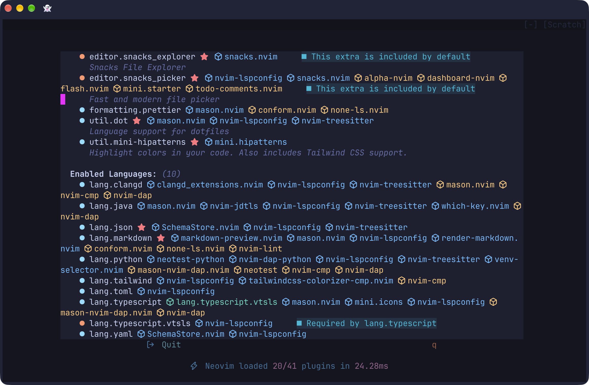

*LazyExtras with the enabled language extras. Entries marked "included by default" or "Required by" were added automatically.*

---

## How it's built

The whole thing rests on four layers:

1. **LazyVim** provides the editor foundation: file explorer, fuzzy search, Git integration, and a plugin manager.
2. **LazyVim Extras + Mason** add language support. Turning on an "extra" (for example `lang.python`) tells Mason to download the matching language server, linter, and formatter. Mason currently manages 31 packages on my machine, including servers such as `pyright`, `clangd`, `jdtls` and `vtsls` and formatters such as `black`, `clang-format`, `google-java-format` and `prettier`.
3. **vim-slime**, a small plugin, "types" text into a terminal window for you. It's the bridge between the code pane and the output pane.
4. **One custom Lua file (`repl.lua`)** ties it together. Its core is a single "smart F5" function that checks the file's extension and picks the right recipe:

```lua
local file_ext = vim.fn.expand("%:e") -- the file's extension: "py", "c", "java"...

if file_ext == "py" then
  -- send IPython a %run command
elseif file_ext == "c" then
  -- compile with gcc, then run
elseif file_ext == "java" then
  -- javac into a temp folder, java, then delete the folder
-- ...and so on for html/css, js, and json
end
```

That design choice turned out to matter. Because each language lives in its own branch, adding a new one never broke an old one. When I asked "will this C change affect my Python setup?", the answer was a simple, verifiable no.

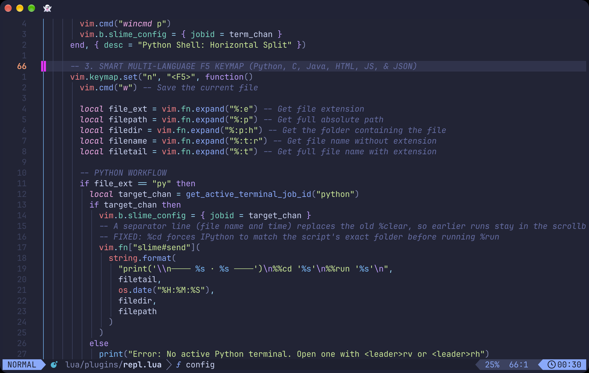

*`repl.lua`: the smart F5 function, which picks a recipe from the file extension.*

### Language by language

**Python**: My original goal was to recreate IDLE's "press F5 and it just runs" feel. Pressing F5 prints a separator line, switches the shell to the file's folder, and runs the script:

```lua
"print('\\n──── %s · %s ────')\n%%cd '%s'\n%%run '%s'\n"
```

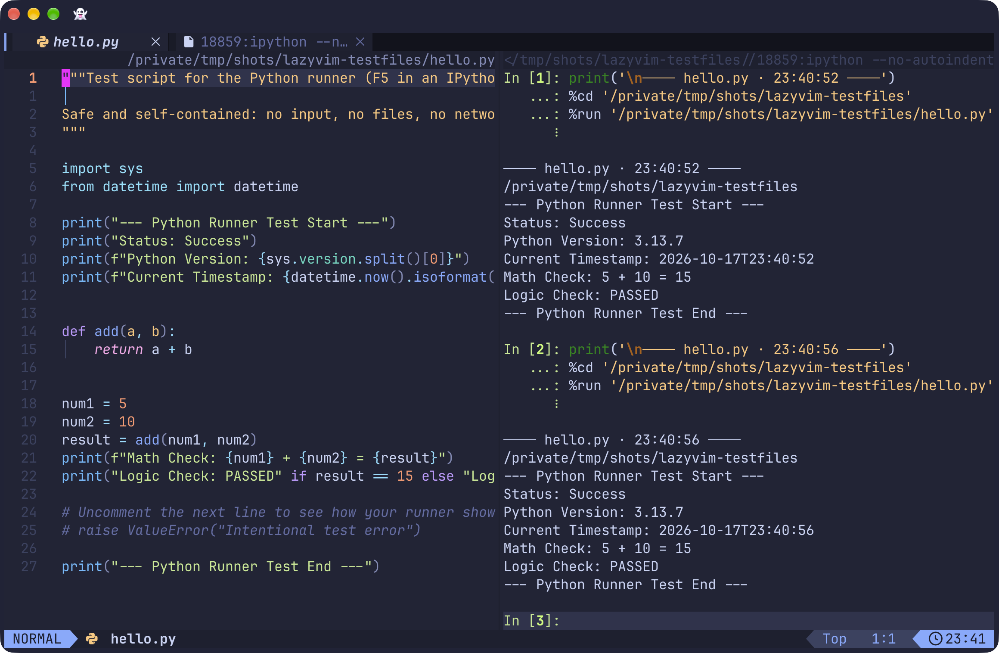

*`hello.py` after two runs with F5. The second run starts below a separator line, and the first run stays above it.*

**C**: One command compiles and runs, and it reuses the same terminal every time:

```lua
"cd '%s' && gcc '%s' -o '%s.out' && clear && ./'%s.out'\n"
```

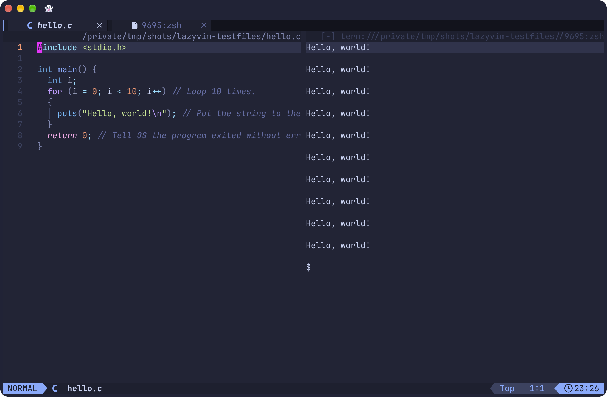

*`hello.c`: ten `Hello, world!` lines in the shell split.*

**Java**: Compile into a temporary folder, run, then delete that folder, in a single chain:

```lua
"cd '%s' && jtmp=$(mktemp -d) && javac -d \"$jtmp\" '%s' && clear && java -cp \"$jtmp:.\" '%s'; rm -rf \"$jtmp\"\n"
```

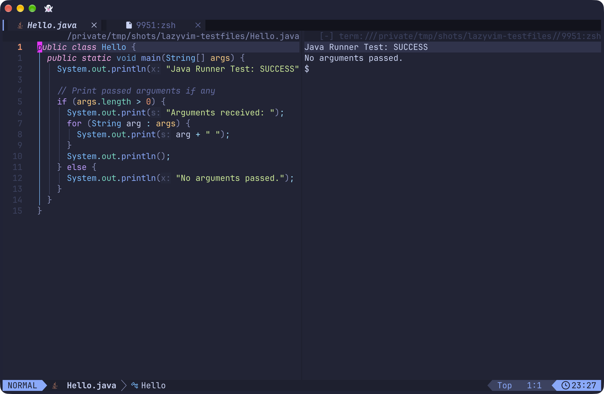

*`Hello.java`: compiled, run and cleaned up in one chain.*

**HTML/CSS**: F5 starts a local server and opens the page in my browser. Every save refreshes it automatically.

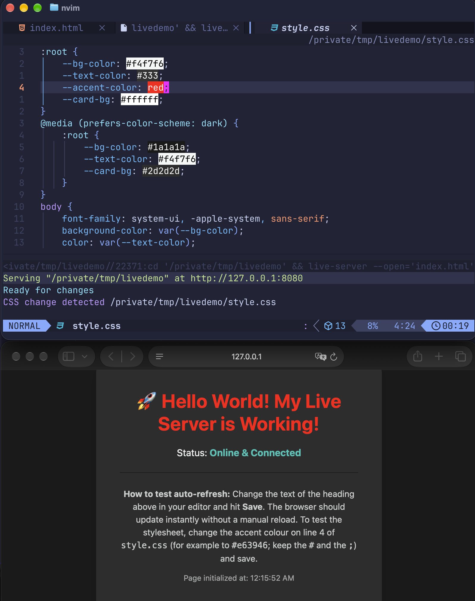

*`style.css` edited and saved: the browser heading turned red by itself, and the server log shows `CSS change detected`.*

**JavaScript & JSON**: JavaScript runs through Node.js. For JSON, F5 doesn't "run" anything (JSON is data, not a program), so it validates the file instead and prints either a ✅ or a pinpointed error.

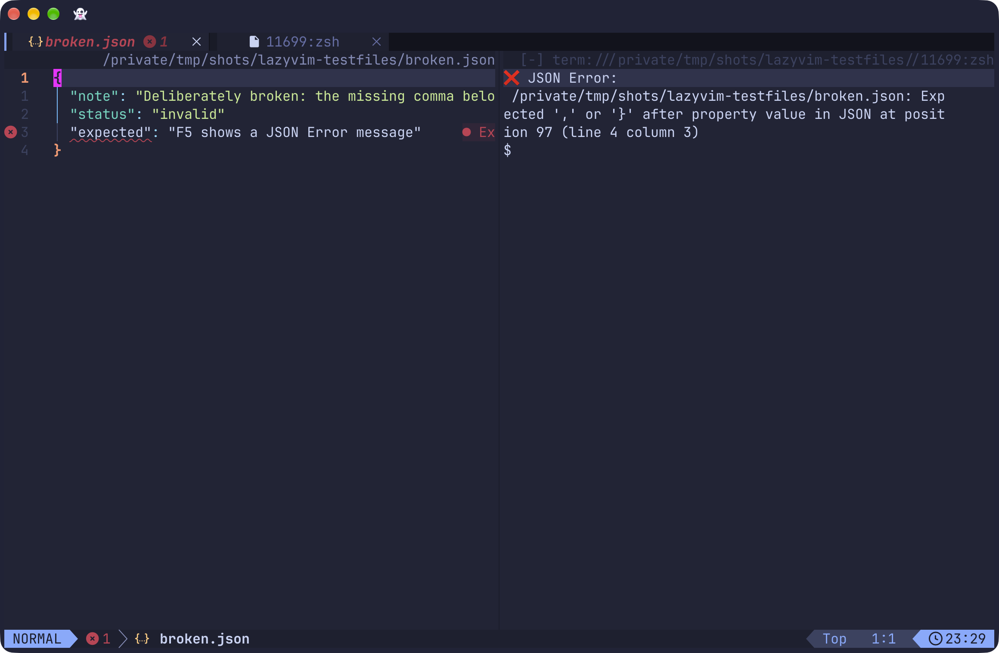

*`broken.json` has a missing comma: F5 prints a pinpointed JSON error.*

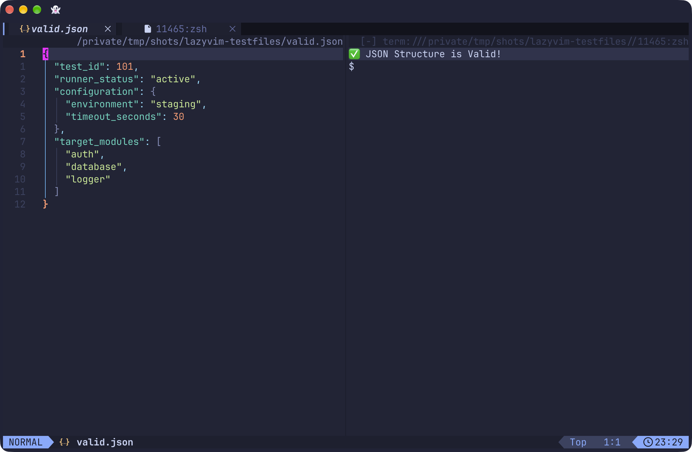

*`valid.json`: F5 prints `JSON Structure is Valid!`.*

The full configuration files are in the [companion guide](https://github.com/james-s-pearson/Cybersecurity-Portfolio/blob/main/foundations/lazyvim-ide/lazyvim-playground-howto.md).

---

## The challenges (and how I got past them)

I built this over about a week with help from an AI assistant (Google's AI Mode). The AI drafted most of the code. My job was to define what "working" meant, test every change, feed back exact error output, and push back when something didn't add up. Almost nothing worked on the first try, and that's where most of the learning happened.

### 1. "This is not running my Python code"

The first attempt opened a shell, but nothing I sent reached it. The plugin didn't know *which* terminal to talk to. The fix was to have the shell-opening shortcut capture the new terminal's ID and hand it to vim-slime automatically, so there's no manual linking.

Then a second problem: the plain `python3` shell got stuck on a `...` prompt whenever I sent a whole file, because it treats pasted multi-line code as one unfinished block. Switching the shell to **IPython**, which handles pasted code cleanly, solved it.

### 2. Chasing IDLE's clean F5 experience: run, don't echo

Even working, the shell printed my entire script back to me before running it. IDLE doesn't do that, and I wanted the same clean experience. The answer was to stop pasting code and send IPython a single `%run path/to/file.py` command instead.

That uncovered two small bugs that taught me a lot about how terminals read commands:
- `clear` isn't a Python command, so IPython threw a `NameError`. Its own "magic" version, `%clear`, worked. (F5 no longer uses it; see the updates below.)
- My folder names contain spaces, which split the file path in two. Wrapping the path in quotes fixed it.

### 3. Don't break the tool you're building on

LazyVim reserves `Space s` for its search menu, and the first version of my shortcuts lived there. I spotted that `Space s h` collided with a built-in search command and asked about it before going further. We moved all of my shortcuts to `Space r` ("run"), which LazyVim leaves free. Lesson: before customizing a tool, learn what it already does.

### 4. The C runner that only worked once

C compiled and ran perfectly… the first time. After that, F5 did nothing in the side split, but it worked every time in LazyVim's own terminal at the bottom of the screen. The cause: the side split ran the compiler as a one-off process, and once the program ended, that split's "channel" was dead, while LazyVim's terminal kept a live shell running behind it. The fix was to always open a persistent shell (`zsh`) first and send commands into it. That pattern became the template for Java, JavaScript, and JSON.

### 5. Java: choosing the right tool, not the cool one

Java has an interactive shell (`jshell`), so the first plan reused the Python approach. It failed twice: once by pasting Java code into a regular shell, and once by pasting before `jshell` had finished starting, which left garbage characters like `^[[200~` on screen.

Before trying another fix, I asked how the proposed approach compared with what I'd do in my normal terminal (Ghostty), and what the tradeoffs were. That conversation led to the right call: treat Java like C. Compile with `javac`, run with `java`, and accept that runs don't share memory the way Python's shell does. A follow-up tweak cleaned up the leftover `.class` files after each run to keep project folders tidy. (That cleanup turned out to be too blunt, because it deleted every class file in the folder. I fixed it later; see "Java stopped deleting files it shouldn't" in the updates below.)

### 6. The web preview that showed a 404

The live server started but showed a 404 page. Two things were tangled together: a startup flag that pointed the server at one specific file, and, again, spaces in my folder path. Serving the whole folder and opening the page by name fixed it.

### 7. A JavaScript file that couldn't find its JSON

My JavaScript test was supposed to read a companion JSON config file. It ran fine but silently ignored the config, because it was looking for a file with a different name than the one I'd created. The updated script scans its own folder for the right JSON file and loads it, whatever it's named.

### 8. Formatting: deciding *when*, not just *how*

Adding formatters raised a design question: should code auto-format every time I save? I asked about the risks first. Automatic formatting can rewrite whole files (noisy Git history), slow down on huge files, and override deliberate layout choices. I decided I wanted **manual formatting on command**.

Getting there included a Lua crash (`E5108`) from a config syntax that no longer matched the formatting plugin's expectations, a Prettier safety setting that refused to format Markdown inside a Git repo without its own config file, and a Markdown linter flagging long lines. Each of those was solved by reading the exact error, not guessing. One problem stayed open for a while: my files still formatted on save despite the config. I found the cause later; it's in the updates below.

### 9. Small things that make it livable

- **A `FileNotFoundError`** appeared when a script opened a text file sitting right next to it. The shell was running from the project root, not the script's folder. F5 now changes into the script's folder before running.
- **Seeing changes without Git:** Vim's `:DiffOrig` command doesn't exist in Neovim by default. Rather than patch around it, I moved my project files into Git and GitHub, which gave me proper diffs and version history.

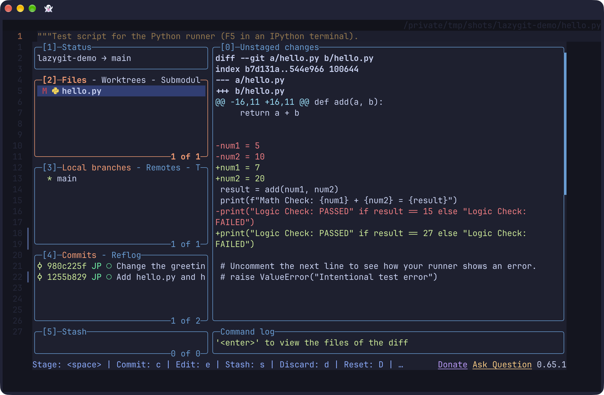

*LazyGit (`Space g g`) in a small demo repo: the changed file on the left, its diff on the right, and the commit history below.*

---

## Updates after weeks of use

The first build worked, but the real test came afterward. Since then I've used the playground for my own coding practice: 27 programs I wrote myself, 28 programs from a coding course, and tens of hours of testing, studying and personal projects, including edits to code snippets of every size.

Using it every day surfaced things a short test run never would. Here's what I found and changed.

### Quality-of-life additions

A few additions made day-to-day coding noticeably smoother:

- **Undotree.** It shows my edit history as a tree, which made navigating undos much easier while I wrote code.
- **A few extras beyond my six languages**, for shell scripts, Go, Git, spell-checking code and an extra CSS toolchain.

**F5 for Markdown.** I wanted Markdown files to work like code does: one key. Now F5 on a `.md` or `.markdown` file opens a live preview in the browser that updates as you type. Each file gets its own tab, and one shortcut closes them all.

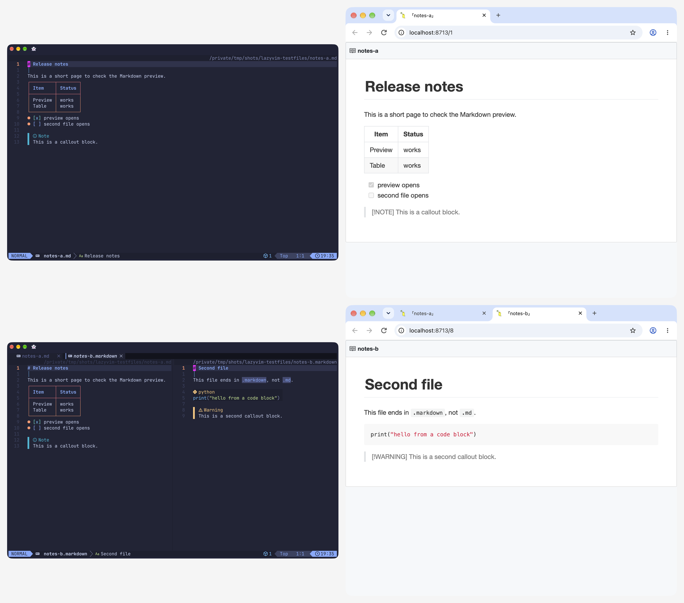

*F5 for Markdown. Top left: a file rendered in the editor. Top right: the browser preview after pressing F5. Bottom left: two files in two splits. Bottom right: one browser tab per file. (The browser window here comes from my test setup; on a normal install the preview opens in your default browser.)*

It isn't perfect: the browser view shows `> [!NOTE]` callouts as plain quotes, while the editor view shows them as note boxes. I'm accepting that for now, since the preview plugin's last update was in October 2023, and I expect to swap it for a more actively maintained option later.

These are all optional. The how-to guide covers them in [Step 8](https://github.com/james-s-pearson/Cybersecurity-Portfolio/blob/main/foundations/lazyvim-ide/lazyvim-playground-howto.md).

### Fixes and changes

**Format-on-save is finally off.** My config said `format_on_save = false`, yet files kept formatting when I saved. The cause: LazyVim switches off conform's own format-on-save setting and runs its own, controlled by `vim.g.autoformat`, which is on by default. (I confirmed this in LazyVim's source code, commit 99970099.) One line in `options.lua` fixed it: `vim.g.autoformat = false`. I checked that saving leaves a badly formatted file alone and that `Space c f` still formats on demand.

**Earlier runs no longer disappear from the Python shell.** F5 used to clear the shell first. I tested what that did: I pressed F5 twice, and run one was gone, with scrolling up stopping at the top of run two. Now F5 prints a separator line (the file name and the time) instead of clearing, so every run stays in the scrollback. When I want a blank screen, I type `clear`. I changed Python only; C, Java, JavaScript and JSON still clear first.

**F5 and F6 now find the right terminal.** They used to grab the first terminal in the list, which could be IPython, LazyGit or a stray shell. Now Python only targets a visible IPython window, and the other languages only a visible plain shell (never IPython, LazyGit or the web server). If there isn't one, F5 says so or opens a new split. Testing turned up a related bug: pressing `Ctrl + /` a second time *hides* the terminal window while its shell keeps running, and F5 had been sending the compile command into that invisible shell, so nothing appeared. The "visible only" rule fixed that too. F6 now closes the terminal you're in, or the newest visible one that isn't LazyGit.

**The web preview tells the truth.** The HTML branch used to print "Live Server running" whenever *any* terminal was open. Now it says so only if a `live-server` for that folder is actually running (a hidden one counts) and starts one otherwise. `live-server` itself still works, but its latest release dates from April 2022 and [Snyk](https://security.snyk.io/package/npm/live-server) lists it as inactive, so replacing it is on my list.

**Java stopped deleting files it shouldn't.** My first cleanup ran `rm -f *.class`, which removes *every* class file in the folder. I reproduced the problem with real `javac` 21: it deleted unrelated `.class` files. Now the runner compiles into a temporary folder, runs from there, and deletes only that folder. It also leaves nothing behind when the code has a compile error.

**Window hopping from a terminal stays, with a known cost.** `Ctrl + h / j / k / l` also work from inside a terminal, which is handy, but it means those four keys no longer reach the shell there: `Ctrl + l` (clear), `Ctrl + k` (delete to end of line), `Ctrl + j` (Enter) and `Ctrl + h` (backspace). I decided to keep them and document the trade-off. I added `Ctrl + o`, which sends `Ctrl + k` to the shell, so delete-to-end-of-line still exists. These four mappings are in section 7 of `repl.lua`. If you'd rather keep those keys for your shell, delete or change those lines after pasting the file. All the shortcuts that run code, plus these window-hopping keys, live in that one file.

**Small cleanups.** I removed two leftover Python run shortcuts (`F4` and `<leader>rp`) that duplicated F5; the cost is that the plain-`python3` run route is gone. I added a window bar (`vim.opt.winbar = "%=%m %F"`) that shows the modified flag and the full file path. And I renamed the shell menu labels from "IDLE Shell" to "Python Shell", because that's what they are.

**One thing I learned about IPython.** `%run` gives each run a clean namespace, like `python3 file.py`: a variable from run one is a `NameError` in run two. But the modules your script *imports* stay cached for the whole session. When I edited a helper module and pressed F5 again, IPython still used the old version, while plain `python3` used the new one. If a change to an imported file doesn't show up, restart the IPython shell. (Tested on Python 3.13.7 and IPython 9.5.0.)

---

## What I took away from it

- **Small, testable steps beat big rewrites.** Every change got tested before the next one. When something broke, I knew exactly which change caused it.
- **Exact error messages are gold.** The fastest fixes came when I pasted the real output instead of describing it.
- **Ask about tradeoffs before committing.** The best decisions (Java via the compiler, manual formatting, moving shortcuts to `Space r`) came from asking "what does this cost me?" first.
- **AI is a strong collaborator, not an autopilot.** It wrote most of the Lua. Catching conflicts, rejecting answers that didn't fit, and deciding what "done" meant was on me. Several of its suggestions also needed correcting along the way, which is why I tested everything.

---

## What's next

- Add F5 support for plain `python3` scripts in a future update (today it needs IPython, since `%run` only works there).
- Bring the "keep earlier output" separator to C, Java, JavaScript and JSON, which still clear the screen first.
- Replace `live-server` with something actively maintained.
- Add support for more languages, such as Bash, Go, and Rust.
- Use the playground for what it was built for: working through coding courses and security labs with less setup friction.

---

## Build it yourself

If you're a learner who wants the same one-key workflow, I wrote a step-by-step guide covering the install, every config file, test files for each language, and the troubleshooting tips I wish I'd had: **[Build Your Own LazyVim Coding Playground →](https://github.com/james-s-pearson/Cybersecurity-Portfolio/blob/main/foundations/lazyvim-ide/lazyvim-playground-howto.md)**

The test files are public too: [a folder of safe, throwaway test files](https://github.com/james-s-pearson/Cybersecurity-Portfolio/tree/main/foundations/lazyvim-ide/lazyvim-testfiles), one per language, so you can check your build without writing your own.

If you build it, or improve it, I'd love to hear about it.

**Find me online:** [LinkedIn](https://www.linkedin.com/in/jamespearson1562) · [GitHub](https://github.com/james-s-pearson) · [Portfolio repository](https://github.com/james-s-pearson/Cybersecurity-Portfolio) · [TryHackMe](https://tryhackme.com/p/JamesPearson)
