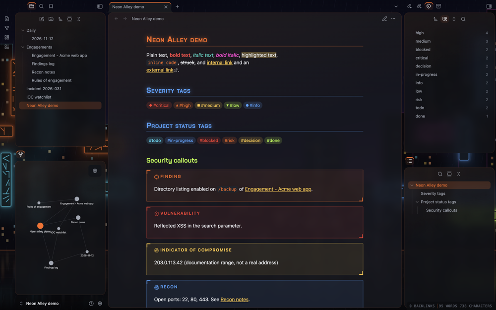
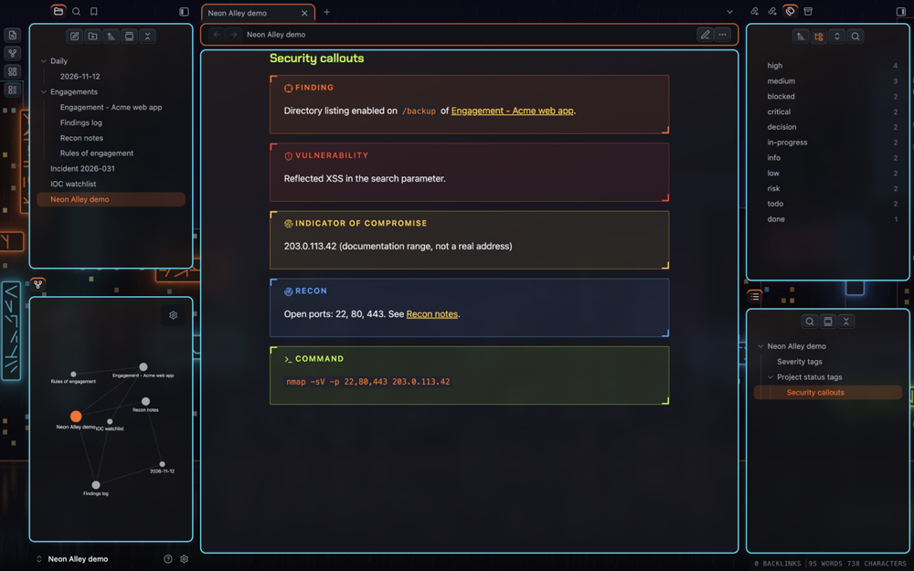
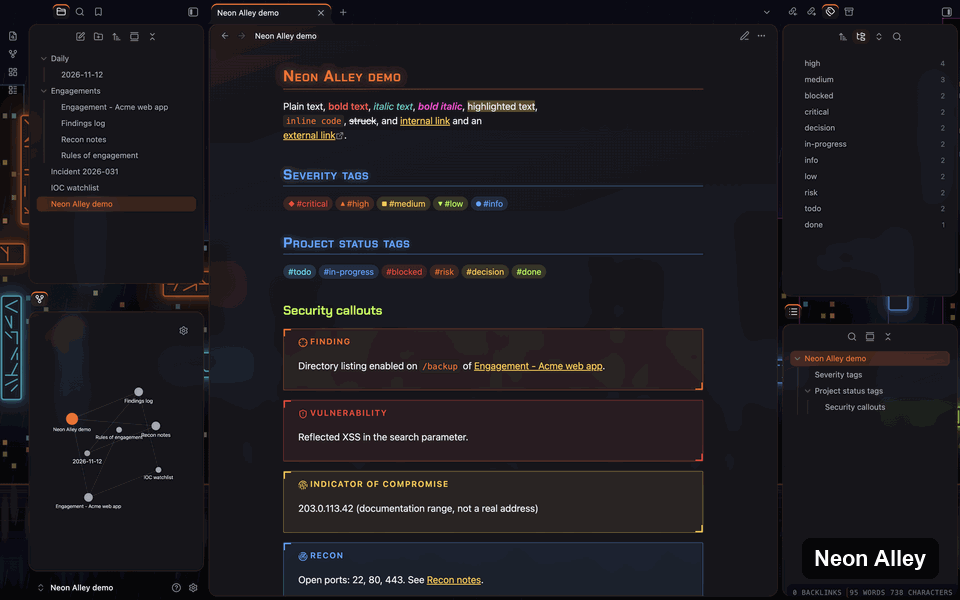
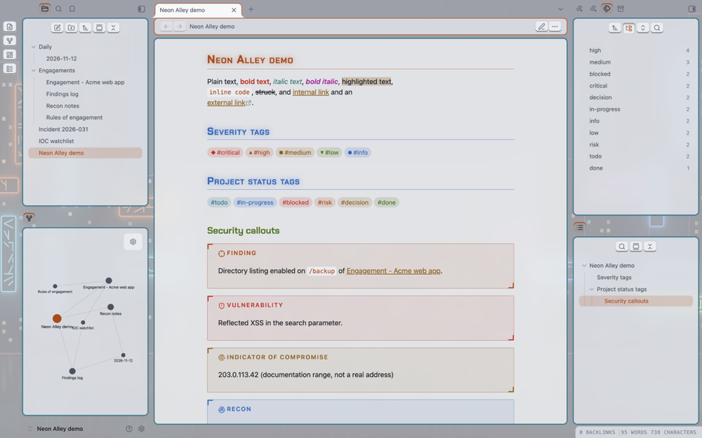
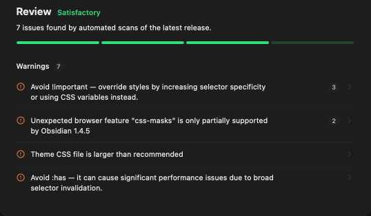
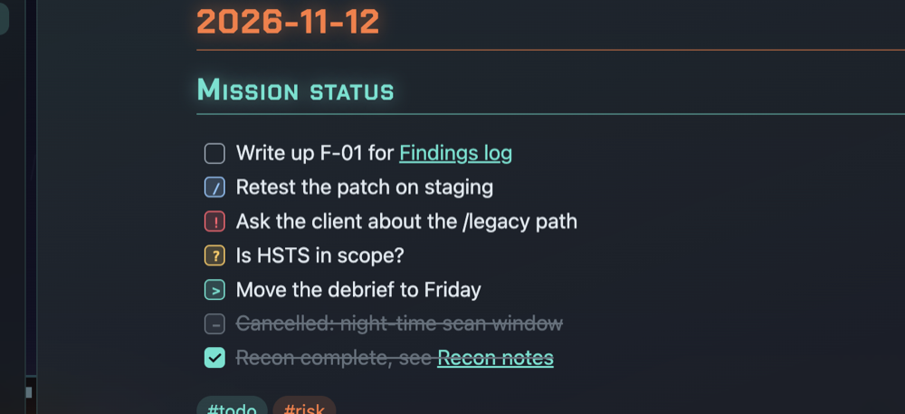

# Neon Alley: designing and shipping an Obsidian theme

> Written with AI assistance (Claude) from my project notes and test
> logs; I reviewed and approved the final wording.

Neon Alley is a theme for [Obsidian](https://obsidian.md), the
note-taking app I use for my security studies and project work. It
turns the app into a city street at night: dark asphalt, traffic-cone
orange and neon signs, with callouts and tags built for security notes.

- Theme repository: [james-s-pearson/neon-alley](https://github.com/james-s-pearson/neon-alley)
- Releases: 1.0.0 and 1.0.1, November 12, 2026 (MIT license)
- Listed in Obsidian's community theme directory on November 12, 2026,
  so it can be installed from inside Obsidian
- Directory listing:
  [community.obsidian.md/themes/neon-alley](https://community.obsidian.md/themes/neon-alley)

## At a glance

- **From a brief to requirements.** Each thing I wanted became a
  requirement with a way to check it; for example, severity tags must
  read without relying on color, so each one also has its own shape.
- **Design decisions, made and recorded.** One theme with four palettes
  instead of three separate themes, a from-scratch rewrite rather than
  inheriting another author's work, and each decision recorded with its
  date and reason.
- **Standards, policy and data protection as release gates.** Every text
  color meets WCAG contrast targets in all eight palette and mode
  combinations, nothing is loaded from the internet, as Obsidian's
  developer policies require, and no real data appears in any public
  image.
- **Secure software delivery.** Every release is published by an
  automated workflow that checks it rebuilds byte for byte from source,
  with its one outside dependency pinned to an exact commit, in line
  with NIST's Secure Software Development Framework (SP 800-218).
- **Change and risk management.** Every change is tested in a clean
  environment before release; one test caught a problem, and the fix
  shipped the same day. The directory review's warnings were triaged:
  risks accepted in writing, the rest scheduled.
- **Directing AI-generated work.** The CSS was generated by AI; I set the
  checks, caught what slipped through and decided what shipped.

## How it was made, and my role

I designed and directed the theme and tested every version. The CSS,
the build tools and the README were generated by Claude (Anthropic's
AI) over many rounds of my feedback. I made the design calls, set the
quality bar, decided what shipped and checked the results on screen.

## From a brief to requirements

Requirements are only useful if they can be checked, in security work as
much as anywhere. I wanted notes that are pleasant to work in for hours
and quick to scan during security work, and each part of that brief
became a requirement I could check:

- **Readable in dark and light mode.** Every text color meets WCAG
  contrast targets: 7:1 for body text, 4.5:1 for colored text and 3:1
  for faint text, checked by a script (see "Standards, policy and data
  protection" below).
- **Callouts for the work I do.** Security callouts (finding,
  vulnerability, indicator of compromise, recon, command and flag) and
  project callouts (risk, decision, blocker, action and done). The flag
  callout stays blurred until you hover over it, so flags and secrets do
  not leak into screenshots.
- **Severity that reads without color.** Severity tags (`#critical` to
  `#info`) each have a shape as well as a color (◆ ▲ ■ ▼ ●); project
  status tags have their own colors.
- **Task states beyond done and not done.** In progress, urgent,
  question, deferred and canceled, each with its own marker.
- **Works without the internet.** Everything the theme needs is inside
  the theme file.

## Design decisions, made and recorded

Each decision below is recorded with its date and reason in the
project's notes, so the reasoning can be reviewed later, the way a risk
or architecture decision should be.

- **One theme with options, not three themes.** Early drafts were three
  separate themes. I merged them into one with four palettes (Neon
  Alley, Sodium Rain, Cold Forge, Polar Ember) and two structures
  (Glass and Retro), which is easier to maintain and to choose from.

- **Rewrite rather than adapt.** One early draft was based on another
  author's theme. The final Retro structure was written from scratch, so
  there is no license question to inherit.
- **Accessibility as a hard rule.** Every text color must meet WCAG
  contrast targets. A small script checks all eight palette and mode
  combinations; a release needs zero failures.
- **Embed, and accept a larger file.** The fonts and the three
  wallpapers are embedded, because Obsidian's policies do not allow
  themes to load files from the internet. That makes the theme file
  larger (about 227 KB: fonts 68 KB, wallpapers 109 KB, CSS 49 KB); a
  smaller version is planned rather than breaking the rule.
- **License:** MIT for the theme; the Chakra Petch font keeps its own
  Open Font License.

## Standards, policy and data protection as release gates

A release gate is a control: if the check fails, the release does not
ship. Every release passes three.

- **Standards compliance.** `tools/contrast.py` checks every text color
  against WCAG contrast targets (7:1 for body text, 4.5:1 for colored
  text and 3:1 for faint text) in all eight palette and mode
  combinations; a release needs 0 failures. Hover effects are also
  turned off when the system asks for reduced motion.
- **Nothing loaded from the internet.** The fonts and the three
  wallpapers are embedded in the theme file, as Obsidian's developer
  policies require. Even the help text avoids showing a web address.
- **Data protection.** Every public image comes from a demo vault of
  fictional notes (documentation-range IP addresses, `example.com`
  domains), never from my own vault, and the flag callout blurs secrets
  so they do not leak into screenshots.

## Secure software delivery

How a release is built and published is part of its security. These
practices line up with the release-integrity and supply-chain practices
in NIST's Secure Software Development Framework (SP 800-218).

- **Release automation with supply-chain care.** A GitHub Actions
  workflow publishes each release from a version tag. Before publishing
  it checks that the tag matches the manifest and that the theme file
  rebuilds byte for byte from source. The only outside action it uses
  is pinned to an exact commit.
- **Security by design.** The theme makes no network requests, pins its
  one outside dependency and verifies every release against its source,
  so nothing reaches users that wasn't reviewed.
- **Versioning and a changelog.** Each release has a version number and
  a changelog entry saying what changed.

## Change and risk management

Every change is treated as a risk until testing says otherwise, and
every known issue is either accepted in writing or scheduled.

- **Change management.** Every release is tested in a brand-new vault
  with no plugins, in dark and light mode, with Obsidian's console
  checked for errors.
- **A same-day fix.** The mission-status task markers passed testing in
  my own vault but failed in the clean demo vault: Obsidian 1.15 records
  a task's status on its line instead of its checkbox, and something in
  my setup had been filling the gap. The theme now handles both, and
  1.0.1 shipped the same day as 1.0.0.
- **Risk acceptance, documented.** Obsidian's automated review rated the
  theme "Satisfactory", with warnings only. Two were accepted with
  written reasons: tag colors must override another popular plugin's,
  and one browser feature is flagged only for Obsidian versions older
  than the theme supports. Two are scheduled for the next version: a
  smaller file, and one slow selector rewritten. The review also noted a
  missing contributing guide, which has since been added.

## Directing AI-generated work

The AI produced the CSS quickly; the quality depended on the checks I
set and on looking at the result on screen. Problems found that way:

- **Task markers that only worked in my vault**, found by the clean-vault
  test in "Change and risk management" above; this is why that test is
  now part of every release.
- **Inline-code style leaking into code blocks.** A rule meant for
  `inline code` also matched code blocks, drawing boxes behind every
  line. Found while testing a darker code theme in my other project,
  Treelights; fixed before release.
- **Gray background on macOS.** With Obsidian's translucent window on,
  the frame took on the system's light-mode material. The theme now
  paints its own backdrop, which also made the wallpapers possible.
- **A dull, washed-out preview image.** I noticed that the palette
  animation in this write-up looked flat next to the real theme. The
  cause was how the image was compressed, not the theme; it was rebuilt
  to keep the original colors.
- **Dropped, not hidden.** Mermaid diagram styling had no visible effect,
  so it was removed rather than shipped half-working.

## Tested on

- macOS, Obsidian 1.15.0 desktop: the full release checks above.
- iPhone and iPad (iOS and iPadOS 27.2.1, Obsidian 1.15.1): dark and
  light mode, callouts and tags, checked by eye.
- Not yet tested: Windows and Linux.

## Next

Version 1.1 adds optional customization (accent, palette, heading,
tag and code colors, heading font, glow strength, corner style) through
the Style Settings or Style Manager plugin, with today's look kept as
the default. It also makes the theme file smaller and rewrites the one
slow selector flagged by the directory review.

## Closing

A theme looks like a low-risk project, but people install it into the
tool where they keep their notes, so I treated it as a product with
users: requirements I could check, gates a release had to pass, and a
supply chain I could account for. The most useful lesson was the
same-day fix: my own vault hid a problem that a clean environment
exposed in minutes. Testing where the user is, not where I am, is a
habit I carry into every project.

Questions or improvements? I'd love to hear how it goes.

**Find me online:**
[LinkedIn](https://www.linkedin.com/in/jamespearson1562) ·
[GitHub](https://github.com/james-s-pearson) ·
[Portfolio repository](https://github.com/james-s-pearson/Cybersecurity-Portfolio)
